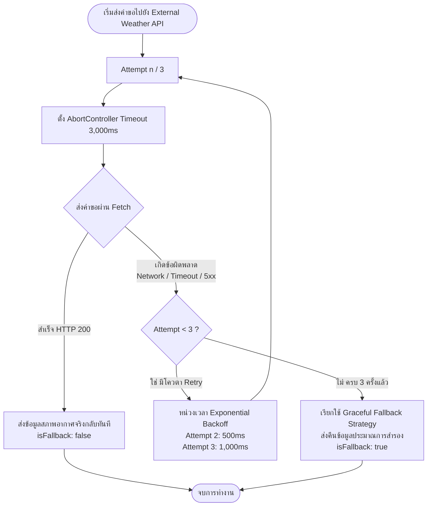

# บันทึกผลการทดสอบ Failure Scenarios (Resilience Integration)
## โครงงานระยะที่ 3: Final Integration & Project Defense
**รหัสนิสิต:** 67160191  
**วิชา:** 88736065 การพัฒนาเว็บเซอร์วิสและเว็บแอปพลิเคชัน (Web Application Programming / API Development)  
**โมดูล:** `services/external-api.js` และ `services/weatherService.js`  
**บริการภายนอกที่เชื่อมต่อ:** Open-Meteo Global Weather Forecast API  

---

## 1. ภาพรวมสถาปัตยกรรมความทนทาน (Resilience Architecture)

ในการเชื่อมต่อกับบริการภายนอก (Third-party API) ระบบได้ออกแบบกลไกความทนทานต่อความล้มเหลว (Fault Tolerance & Resilience) 3 ลำดับชั้น:



### การกำหนดค่าพารามิเตอร์หลัก (Configuration):
- **Timeout:** สูงสุด `3,000ms` ควบคุมด้วย `AbortController`
- **Max Retries:** เรียกซ้ำสูงสุด `2 ครั้ง` (รวมความพยายามทั้งหมด `3 Attempts`)
- **Backoff Strategy:** Exponential Backoff เริ่มต้น `500ms` (Attempt 2: รอ 500ms, Attempt 3: รอ 1,000ms)
- **Fallback Strategy:** ส่งคืนข้อมูลสภาพอากาศเฉลี่ยของพื้นที่พร้อมคำแนะนำความปลอดภัย โดยเซิร์ฟเวอร์ยังคงตอบ HTTP 200 ไม่เกิด Crash

---

## 2. ผลการทดสอบทั้ง 4 สถานการณ์ (4 Failure Scenarios)

### สถานการณ์ที่ 1: การทำงานปกติ (Scenario 1 — Normal Operation / Happy Path)
- **สภาวะการทดสอบ:** เรียกบริการ Open-Meteo Weather API ของจริงที่พิกัดกรุงเทพฯ (`lat=13.75, lon=100.51`)
- **ผลลัพธ์ที่คาดหวัง:** ได้รับข้อมูลจริงในความพยายามครั้งแรก (Attempt 1) ไม่มีการ Retry
- **ผลการทดสอบจริง:**
  ```text
  --- [WeatherService] เริ่มต้นดึงข้อมูลสภาพอากาศ ---
  พารามิเตอร์: Lat=13.75, Lon=100.51, City=Bangkok, MockMode=none
  การตั้งค่า Resilience: Timeout=3000ms, Max Retries=2 (Total Attempts=3)

  [WeatherService] Attempt 1/3 กำลังส่งคำขอ...
  [WeatherService] Attempt 1 สำเร็จเรียบร้อย! HTTP Status: 200

  ผลลัพธ์:
  - Success: true
  - Is Fallback: false
  - Attempts Made: 1
  - Condition: มีเมฆมาก (Overcast)
  - Temperature: 25.7°C
  - Recommendation: แดดไม่แรง เหมาะสำหรับกิจกรรมนอกสถานที่ แต่อาจมีเมฆสะสม
  ```

---

### สถานการณ์ที่ 2: ข้อผิดพลาดเครือข่าย (Scenario 2 — Network Failure / Unreachable Domain)
- **สภาวะการทดสอบ:** จำลอง DNS Failure หรือโดเมนปลายทางไม่สามารถเข้าถึงได้ (`mockFailure=network`)
- **ผลลัพธ์ที่คาดหวัง:** ระบบตรวจจับ Network Error และทำการ Retry อัตโนมัติ 2 ครั้ง พร้อมหน่วงเวลาแบบ Exponential Backoff ก่อนสลับไปใช้ Fallback
- **ผลการทดสอบจริง:**
  ```text
  --- [WeatherService] เริ่มต้นดึงข้อมูลสภาพอากาศ ---
  พารามิเตอร์: Lat=13.75, Lon=100.51, City=Bangkok, MockMode=network
  การตั้งค่า Resilience: Timeout=3000ms, Max Retries=2 (Total Attempts=3)

  [WeatherService] Attempt 1/3 กำลังส่งคำขอ...
    [SIMULATION] กำลังจำลอง Network Error (Domain Unreachable)...
  [WeatherService] Attempt 1 ล้มเหลว! สาเหตุ: fetch failed
  [WeatherService] กลไก Retry ทำงาน: กำลังรอ 500ms ก่อนเริ่ม Attempt 2...

  [WeatherService] Attempt 2/3 กำลังส่งคำขอ...
    [SIMULATION] กำลังจำลอง Network Error (Domain Unreachable)...
  [WeatherService] Attempt 2 ล้มเหลว! สาเหตุ: fetch failed
  [WeatherService] กลไก Retry ทำงาน: กำลังรอ 1000ms ก่อนเริ่ม Attempt 3...

  [WeatherService] Attempt 3/3 กำลังส่งคำขอ...
    [SIMULATION] กำลังจำลอง Network Error (Domain Unreachable)...
  [WeatherService] Attempt 3 ล้มเหลว! สาเหตุ: fetch failed

  [WeatherService] ทุก Attempt ล้มเหลวทั้งหมด (3/3)
  [WeatherService] กำลังเรียกใช้ Fallback Strategy เพื่อตอบสนองต่อผู้ใช้อย่างปลอดภัย...

  ผลลัพธ์:
  - Success: true
  - Is Fallback: true
  - Attempts Made: 3
  - Status: FAILED_AFTER_RETRIES
  - Error Reason: fetch failed
  - Fallback Message: ไม่สามารถเชื่อมต่อบริการสภาพอากาศภายนอกได้ในขณะนี้ ระบบใช้ข้อมูลประมาณการสำรอง (Fallback Strategy)
  ```

---

### สถานการณ์ที่ 3: ข้อผิดพลาดการเชื่อมต่อเกินเวลา (Scenario 3 — Timeout Failure)
- **สภาวะการทดสอบ:** จำลองเซิร์ฟเวอร์ภายนอกตอบสนองช้ามากผิดปกติ (Latency > 1,500ms) โดยตั้งค่า Timeout ไว้ที่ 1,000ms (`mockFailure=timeout`)
- **ผลลัพธ์ที่คาดหวัง:** `AbortController` ทำการตัด Connection ทันทีที่ครบ 1,000ms และเข้าสู่วงจร Retry จนครบ 3 ครั้ง
- **ผลการทดสอบจริง:**
  ```text
  --- [WeatherService] เริ่มต้นดึงข้อมูลสภาพอากาศ ---
  พารามิเตอร์: Lat=13.75, Lon=100.51, City=Bangkok, MockMode=timeout
  การตั้งค่า Resilience: Timeout=1000ms, Max Retries=2 (Total Attempts=3)

  [WeatherService] Attempt 1/3 กำลังส่งคำขอ...
    [SIMULATION] กำลังจำลอง API ตอบสนองช้ามาก (Delay 6,000ms > Timeout 1000ms)...
  [WeatherService] Attempt 1 ล้มเหลว! สาเหตุ: Timeout เกิน 1000ms
  [WeatherService] กลไก Retry ทำงาน: กำลังรอ 500ms ก่อนเริ่ม Attempt 2...

  [WeatherService] Attempt 2/3 กำลังส่งคำขอ...
    [SIMULATION] กำลังจำลอง API ตอบสนองช้ามาก (Delay 6,000ms > Timeout 1000ms)...
  [WeatherService] Attempt 2 ล้มเหลว! สาเหตุ: Timeout เกิน 1000ms
  [WeatherService] กลไก Retry ทำงาน: กำลังรอ 1000ms ก่อนเริ่ม Attempt 3...

  [WeatherService] Attempt 3/3 กำลังส่งคำขอ...
    [SIMULATION] กำลังจำลอง API ตอบสนองช้ามาก (Delay 6,000ms > Timeout 1000ms)...
  [WeatherService] Attempt 3 ล้มเหลว! สาเหตุ: Timeout เกิน 1000ms

  [WeatherService] ทุก Attempt ล้มเหลวทั้งหมด (3/3)
  [WeatherService] กำลังเรียกใช้ Fallback Strategy เพื่อตอบสนองต่อผู้ใช้อย่างปลอดภัย...

  ผลลัพธ์:
  - Success: true
  - Is Fallback: true
  - Attempts Made: 3
  - Status: FAILED_AFTER_RETRIES
  - Error Reason: Request timeout เกินเวลาที่กำหนด (1000ms)
  ```

---

### สถานการณ์ที่ 4: ข้อผิดพลาดของเซิร์ฟเวอร์ภายนอก (Scenario 4 — 5xx Server Error)
- **สภาวะการทดสอบ:** เซิร์ฟเวอร์ภายนอกขัดข้องภายใน คืนรหัส HTTP 500 (`mockFailure=500`)
- **ผลลัพธ์ที่คาดหวัง:** ระบบไม่ตีความว่าเป็นข้อผิดพลาดของผู้ใช้ (ไม่ใช่ 4xx) จึงทำการ Retry เพื่อรอให้ฝั่งผู้ให้บริการฟื้นตัว เมื่อครบจำนวนครั้งแล้วจึง Fallback
- **ผลการทดสอบจริง:**
  ```text
  --- [WeatherService] เริ่มต้นดึงข้อมูลสภาพอากาศ ---
  พารามิเตอร์: Lat=13.75, Lon=100.51, City=Bangkok, MockMode=500
  การตั้งค่า Resilience: Timeout=3000ms, Max Retries=2 (Total Attempts=3)

  [WeatherService] Attempt 1/3 กำลังส่งคำขอ...
    [SIMULATION] กำลังจำลอง External Server Error (HTTP 500)...
  [WeatherService] Attempt 1 ล้มเหลว! สาเหตุ: External API ตอบกลับด้วยรหัสข้อผิดพลาด HTTP 500 (INTERNAL SERVER ERROR)
  [WeatherService] กลไก Retry ทำงาน: กำลังรอ 500ms ก่อนเริ่ม Attempt 2...

  [WeatherService] Attempt 2/3 กำลังส่งคำขอ...
    [SIMULATION] กำลังจำลอง External Server Error (HTTP 500)...
  [WeatherService] Attempt 2 ล้มเหลว! สาเหตุ: External API ตอบกลับด้วยรหัสข้อผิดพลาด HTTP 500 (INTERNAL SERVER ERROR)
  [WeatherService] กลไก Retry ทำงาน: กำลังรอ 1000ms ก่อนเริ่ม Attempt 3...

  [WeatherService] Attempt 3/3 กำลังส่งคำขอ...
    [SIMULATION] กำลังจำลอง External Server Error (HTTP 500)...
  [WeatherService] Attempt 3 ล้มเหลว! สาเหตุ: External API ตอบกลับด้วยรหัสข้อผิดพลาด HTTP 500 (INTERNAL SERVER ERROR)

  [WeatherService] ทุก Attempt ล้มเหลวทั้งหมด (3/3)
  [WeatherService] กำลังเรียกใช้ Fallback Strategy เพื่อตอบสนองต่อผู้ใช้อย่างปลอดภัย...

  ผลลัพธ์:
  - Success: true
  - Is Fallback: true
  - Attempts Made: 3
  - Status: FAILED_AFTER_RETRIES
  - Error Reason: External API ตอบกลับด้วยรหัสข้อผิดพลาด HTTP 500 (INTERNAL SERVER ERROR)
  ```

---

## 3. ตัวอย่างโครงสร้าง JSON Response เมื่อเกิด Fallback

```json
{
  "success": true,
  "isFallback": true,
  "message": "ไม่สามารถเชื่อมต่อบริการสภาพอากาศภายนอกได้ในขณะนี้ ระบบใช้ข้อมูลประมาณการสำรอง (Fallback Strategy)",
  "weather": {
    "city": "Bangkok",
    "temperature_celsius": 30.0,
    "condition": "สภาพอากาศประมาณการ (Estimated / Fallback Data)",
    "recommendation": "ข้อมูลสภาพอากาศภายนอกไม่พร้อมให้บริการ กรุณาตรวจสอบสภาพอากาศจากแอปพลิเคชันหลักก่อนปฏิบัติงานกลางแจ้ง",
    "isFallback": true
  },
  "resilienceMeta": {
    "status": "FAILED_AFTER_RETRIES",
    "attemptsMade": 3,
    "maxRetries": 2,
    "timeoutMs": 3000,
    "errorReason": "External API ตอบกลับด้วยรหัสข้อผิดพลาด HTTP 500 (INTERNAL SERVER ERROR)",
    "timestamp": "2026-10-26T13:12:16.892Z"
  }
}
```

---

## 4. สรุปคุณค่าทางสถาปัตยกรรม (Architectural Value)

1. **High Availability:** ระบบหลักยังคงให้บริการได้ตามปกติ แม้ระบบสภาพอากาศภายนอกจะล่มทั้งหมด
2. **Prevent Cascading Failures:** การใช้ `AbortController` ป้องกันปัญหา Connection Pool หรือ Thread Exhaustion ใน Node.js
3. **Transparency & Observability:** ฟิลด์ `resilienceMeta` ทำให้ทั้งหน้าบ้าน Frontend และทีมพัฒนาสามารถตรวจสอบได้ทันทีว่าคำขอนั้นผ่านการ Retry มาแล้วกี่ครั้งและเกิดจากสาเหตุใด
