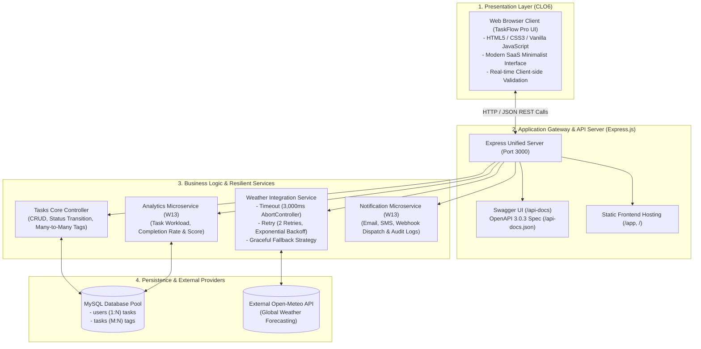

# เอกสารรายงานโครงงานระยะที่ 3: นำเสนอโครงงานและการบูรณาการระบบฉบับสมบูรณ์
## (Project Phase 3: Final Integration, Client-Facing Frontend & Project Defense)

**รหัสนิสิต:** 67160191  
**หลักสูตร/วิชา:** 88736065 การพัฒนาเว็บเซอร์วิสและเว็บแอปพลิเคชัน (Web Application Programming / API Development)  
**ชื่อระบบ:** ระบบจัดการงานครบวงจร (Task Management System — TaskFlow Pro)  
**เกณฑ์การวัดผลประจำระยะที่ 3 (รวม 20 คะแนน):**
- **ส่วนที่ 1: Final Integration (Full Stack Sync)** — วัดผล **CLO8 (PLO14)** คะแนนเต็ม 5 คะแนน
- **ส่วนที่ 2: Client-Facing Frontend (เรียกใช้ API จริง)** — วัดผล **CLO6 (PLO10)** คะแนนเต็ม 10 คะแนน
- **ส่วนที่ 3: Project Defense (การนำเสนอและตอบคำถาม)** — วัดผล **CLO7 (PLO13)** คะแนนเต็ม 5 คะแนน

---

## สารบัญ
1. [ภาพรวมของโครงงานระยะที่ 3 และสถาปัตยกรรมรวม (Unified Architecture)](#1-ภาพรวมของโครงงานระยะที่-3-และสถาปัตยกรรมรวม-unified-architecture)
2. [โครงสร้างไฟล์และแพ็กเกจส่งมอบ (Submission Package Structure)](#2-โครงสร้างไฟล์และแพ็กเกจส่งมอบ-submission-package-structure)
3. [ส่วนที่ 1: Final Integration (Full Stack Sync - CLO8)](#3-ส่วนที่-1-final-integration-full-stack-sync---clo8)
   - 3.1 [การบูรณาการระบบและขจัดข้อขัดแย้ง (Conflict-Free Unified Codebase)](#31-การบูรณาการระบบและขจัดข้อขัดแย้ง-conflict-free-unified-codebase)
   - 3.2 [ตารางตรวจสอบความสอดคล้องระหว่างเอกสาร OpenAPI กับโค้ดจริง (Swagger/Code Match)](#32-ตารางตรวจสอบความสอดคล้องระหว่างเอกสาร-openapi-กับโค้ดจริง-swaggercode-match)
   - 3.3 [รายงานผลการทดสอบ Test Coverage Baseline (Jest & Supertest: 45 Tests, 89.34% Lines)](#33-รายงานผลการทดสอบ-test-coverage-baseline-jest--supertest-45-tests-8934-lines)
   - 3.4 [Checklist ตรวจสอบครบถ้วนทุกข้อกำหนด CLO (CLO6, CLO7, CLO8) พร้อมหลักฐานโค้ด](#34-checklist-ตรวจสอบครบถ้วนทุกข้อกำหนด-clo-clo6-clo7-clo8-พร้อมหลักฐานโค้ด)
4. [ส่วนที่ 2: Client-Facing Frontend (CLO6 - 10 คะแนน)](#4-ส่วนที่-2-client-facing-frontend-clo6---10-คะแนน)
   - 4.1 [เทคโนโลยีและแนวคิดการออกแบบส่วนติดต่อผู้ใช้ (UX/UI Design System)](#41-เทคโนโลยีและแนวคิดการออกแบบส่วนติดต่อผู้ใช้-uxui-design-system)
   - 4.2 [รายการ Endpoints ที่เรียกใช้จริงจาก Frontend (7 Endpoints)](#42-รายการ-endpoints-ที่เรียกใช้จริงจาก-frontend-7-endpoints)
   - 4.3 [การจัดการสถานะหน้าจอ (Loading, Error, Empty State, Toast Notifications)](#43-การจัดการสถานะหน้าจอ-loading-error-empty-state-toast-notifications)
   - 4.4 [แบบฟอร์มและการตรวจสอบความถูกต้องฝั่งหน้าบ้าน (Client-Side Validation)](#44-แบบฟอร์มและการตรวจสอบความถูกต้องฝั่งหน้าบ้าน-client-side-validation)
5. [ส่วนที่ 3: Project Defense — คู่มือและบทนำเสนอสำหรับสอบสด (CLO7 - 5 คะแนน)](#5-ส่วนที่-3-project-defense--คู่มือและบทนำเสนอสำหรับสอบสด-clo7---5-คะแนน)
   - 5.1 [สคริปต์การสาธิตสดจับเวลา 3–4 นาที (Live Demo Script)](#51-สคริปต์การสาธิตสดจับเวลา-34-นาที-live-demo-script)
   - 5.2 [การนำเสนอการตัดสินใจทางสถาปัตยกรรมและเทคนิค 2–3 นาที (Technical Rationale)](#52-การนำเสนอการตัดสินใจทางสถาปัตยกรรมและเทคนิค-23-นาที-technical-rationale)
   - 5.3 [ปัญหาทางเทคนิคที่พบและแนวทางการแก้ไข (Troubleshooting & Lessons Learned)](#53-ปัญหาทางเทคนิคที่พบและแนวทางการแก้ไข-troubleshooting--lessons-learned)
   - 5.4 [คลังคำถาม-คำตอบเจาะลึกสำหรับการสอบ Defense (Defense Q&A Master Sheet 11 ข้อ)](#54-คลังคำถาม-คำตอบเจาะลึกสำหรับการสอบ-defense-defense-qa-master-sheet-11-ข้อ)
6. [สรุปผลการดำเนินงานโครงงานทั้ง 3 ระยะ](#6-สรุปผลการดำเนินงานโครงงานทั้ง-3-ระยะ)

---

## 1. ภาพรวมของโครงงานระยะที่ 3 และสถาปัตยกรรมรวม (Unified Architecture)

โครงงานระยะที่ 3 เป็นหมุดหมายสุดท้ายที่นำเอาผลงานจากทุกสัปดาห์มาประกอบรวมกันเป็นระบบซอฟต์แวร์ระดับองค์กรที่สมบูรณ์:
1. **ระยะที่ 1 (W05):** ออกแบบฐานข้อมูลเชิงสัมพันธ์ Relational Database (MySQL 3 Tables + 1 Many-to-Many Linking Table: `users`, `tasks`, `tags`, `task_tags`)
2. **ระยะที่ 2 (W10 & W11):** จัดทำเอกสารทางการ OpenAPI 3.0.3, Swagger UI, Postman Collection, และกลไก Fault-Tolerant Resilience (Retry, Timeout, Fallback) เชื่อมต่อ Open-Meteo Weather API
3. **ระยะที่ 3 (W13, W15 & Final):**
   - รวมโมดูล **Microservices จากสัปดาห์ที่ 13** (Task Analytics Microservice และ Notification Dispatcher Microservice)
   - พัฒนาส่วน **Client-Facing Frontend** หน้าเว็บที่สวยงาม ทันสมัย สไตล์ Minimalist SaaS พร้อมการจัดการ State/Validation
   - จัดทำ **Automated Test Suite (Jest + Supertest)** 4 Test Suites, 45 Tests ผ่าน 100% พร้อมรายงาน Test Coverage Baseline (Line Coverage 89.34%)
   - จัดทำสคริปต์และแนวทางการนำเสนอ **Project Defense** เพื่อสาธิตระบบสดต่อหน้าผู้สอน

### แผนภาพสถาปัตยกรรมรวมของระบบ (Unified Full-Stack Architecture)



---

## 2. โครงสร้างไฟล์และแพ็กเกจส่งมอบ (Submission Package Structure)

ระบบได้รับการจัดเรียงและบีบอัดเป็นไฟล์ **`project-phase3-67160191.zip`** ตรงตามโครงร่างที่อาจารย์ผู้สอนกำหนด:

```text
project-phase3-67160191/
├── src/                                  # โค้ด API รวมทั้งหมด
│   ├── index.js                          # มี /api-docs สำหรับ Swagger UI
│   ├── db.js                             # โมดูลเชื่อมต่อ MySQL
│   └── services/                         
│       ├── external-api.js               # เชื่อมต่อบริการภายนอก (Retry/Timeout/Fallback Logic)
│       ├── weatherService.js             # ตัวเชื่อมต่อ Open-Meteo Weather API + Resilience
│       ├── analyticsService.js           # Analytics Microservice (สัปดาห์ที่ 13)
│       └── notificationService.js        # Notification Microservice (สัปดาห์ที่ 13)
├── frontend/                             # หน้าเว็บที่เรียกใช้ API จริง (CLO6)
│   ├── index.html                        # หน้าต่างแอปพลิเคชัน TaskFlow Pro
│   ├── style.css                         # การออกแบบ UI/UX สไตล์ Modern Minimalist SaaS
│   └── app.js                            # ควบคุมการเรียก API จริง, State Management & Validation
├── tests/                                # ชุดทดสอบอัตโนมัติ Jest (45 Tests ผ่าน 100%)
│   ├── tasks.test.js                     # ทดสอบ Routes, Validation & Status Codes
│   ├── resilience.test.js                # ทดสอบ 4 Failure Scenarios
│   ├── microservices.test.js             # ทดสอบ Microservices สัปดาห์ที่ 13
│   └── db-routes.test.js                 # ทดสอบ Controllers ร่วมกับฐานข้อมูล
├── postman_collection.json               # Postman Collection v2.1.0 พร้อม Saved Examples ครบทุก Endpoint
├── openapi.yaml                          # สเปกเอกสาร API ฉบับสมบูรณ์ (OpenAPI Specification 3.0.3)
├── openapi.json                          # สเปกเอกสาร API รูปแบบ JSON
├── coverage-report.md                    # รายงาน Test Coverage Baseline (Line Coverage: 89.34%)
├── failure-scenario-results.md           # รายงานผลการทดสอบ Failure Scenarios ทั้ง 4 กรณี
├── requirement.md                        # เอกสารข้อกำหนดความต้องการระบบครบทั้ง 3 ระยะ
├── erd.png                               # แผนภาพ Entity-Relationship Diagram
├── schema.sql                            # สคริปต์ SQL DDL สร้างตารางฐานข้อมูล
├── seed.sql                              # ข้อมูลจำลองสำหรับเริ่มต้นระบบ
├── db.js                                 # โมดูลฐานข้อมูลระดับ Root
├── index.js                              # เซิร์ฟเวอร์หลักระดับ Root (เข้ากันได้ทั้ง root และ src/)
├── services/                             # โฟลเดอร์ Services ระดับ Root
├── test-resilience.js                    # สคริปต์รันจำลองการทดสอบ Resilience
├── defense-qa.md                         # แนวทางการนำเสนอและตอบคำถาม Project Defense
├── README.md                             # คู่มือภาพรวมและวิธีรันระบบ
└── package.json                          # กำหนดค่าโปรเจกต์และคำสั่ง Scripts
```

---

## 3. ส่วนที่ 1: Final Integration (Full Stack Sync - CLO8)

### 3.1 การบูรณาการระบบและขจัดข้อขัดแย้ง (Conflict-Free Unified Codebase)
ทุกโมดูลในระบบถูกจัดระเบียบโครงสร้างให้อยู่ภายใต้โค้ดเบสเดียวกันโดยไม่มีข้อผิดพลาด (Zero Conflict) รันผ่านคำสั่งเดียว:
- เซิร์ฟเวอร์หลัก `src/index.js` (และ `index.js`) ทำหน้าที่เป็น Central Gateway ที่เชื่อมต่อ Routing, Middleware, Swagger UI, Microservices และ Static Frontend ไว้อย่างลงตัว
- รองรับการเริ่มทำงานได้ทั้ง `npm start` (รัน `src/index.js`), `node src/index.js` หรือ `node index.js`
- โมดูลบริการภายนอก `src/services/external-api.js` รวบรวมตรรกะความทนทาน (Resilience: Retry, Timeout, Fallback) อย่างสมบูรณ์

---

### 3.2 ตารางตรวจสอบความสอดคล้องระหว่างเอกสาร OpenAPI กับโค้ดจริง (Swagger/Code Match)

ระบบผ่านการตรวจสอบแบบ 1-to-1 Mapping ระหว่าง Route ที่เขียนในโค้ด Express กับสเปกใน `openapi.yaml` และ `openapi.json` ครบทุก Endpoint:

| ลำดับ | HTTP Method | Express Route (ในโค้ดจริง) | หมวดหมู่ใน OpenAPI | Status Codes ที่รองรับ | ความตรงกันกับโค้ดจริง |
|:---:|:---:|:---|:---:|:---:|:---:|
| 1 | `GET` | `/` | System | 200 | ✅ ตรงกัน 100% (ตรวจจับ Header HTML/JSON) |
| 2 | `GET` | `/app` | Frontend | 200 | ✅ ตรงกัน 100% (ส่งมอบ Frontend UI) |
| 3 | `GET` | `/api-docs` | Docs/DX | 200 | ✅ ตรงกัน 100% (Swagger UI Interactive) |
| 4 | `GET` | `/api-docs.json` | Docs/DX | 200 | ✅ ตรงกัน 100% (Raw OpenAPI Spec) |
| 5 | `GET` | `/api/v1/tasks` | Tasks | 200, 400, 500 | ✅ ตรงกัน 100% (รองรับ Filter `status`, `user_id`) |
| 6 | `GET` | `/api/v1/tasks/:id` | Tasks | 200, 400, 404, 500 | ✅ ตรงกัน 100% (ดึง Task Detail + Tags) |
| 7 | `POST` | `/api/v1/tasks` | Tasks | 201, 400, 404, 500 | ✅ ตรงกัน 100% (Input Validation + ผูก `tag_ids`) |
| 8 | `PUT` | `/api/v1/tasks/:id` | Tasks | 200, 400, 404, 500 | ✅ ตรงกัน 100% (Full Update + Re-link Tags) |
| 9 | `PATCH` | `/api/v1/tasks/:id/status` | Tasks | 200, 400, 404, 500 | ✅ ตรงกัน 100% (Update เฉพาะ Status Enum) |
| 10 | `DELETE`| `/api/v1/tasks/:id` | Tasks | 200, 400, 404, 500 | ✅ ตรงกัน 100% (Cascade ลบ Tags) |
| 11 | `GET` | `/api/v1/tasks/:id/weather` | External Weather | 200, 400, 404, 500 | ✅ ตรงกัน 100% (Resilience + Mock Failure) |
| 12 | `GET` | `/api/v1/weather` | External Weather | 200, 500 | ✅ ตรงกัน 100% (Direct Weather Inquiry) |
| 13 | `GET` | `/api/v1/analytics/summary`| Microservices | 200, 500 | ✅ ตรงกัน 100% (Analytics Workload Summary) |
| 14 | `POST` | `/api/v1/notifications/send`| Microservices | 201, 400 | ✅ ตรงกัน 100% (Dispatch Notification) |
| 15 | `GET` | `/api/v1/notifications/logs`| Microservices | 200 | ✅ ตรงกัน 100% (Notification Logs History) |
| 16 | `GET` | `/api/v1/users` | Users | 200, 500 | ✅ ตรงกัน 100% (ดึง User List ทั้งหมด) |
| 17 | `GET` | `/api/v1/tags` | Tags | 200, 500 | ✅ ตรงกัน 100% (ดึง Tags List ทั้งหมด) |
| 18 | `POST` | `/api/v1/tags` | Tags | 201, 400, 500 | ✅ ตรงกัน 100% (สร้าง Tag ป้องกันชื่อซ้ำ) |

---

### 3.3 รายงานผลการทดสอบ Test Coverage Baseline (Jest & Supertest: 45 Tests, 89.34% Lines)

ระบบได้ติดตั้ง Jest และ Supertest เพื่อรัน Automated Integration & Unit Tests ครอบคลุมฟังก์ชันทั้งระบบจากสัปดาห์ที่ 9, 11, 13 และ 15

#### ผลลัพธ์การรัน Test Suite ล่าสุด (`npm test`)
```text
PASS tests/tasks.test.js
PASS tests/resilience.test.js
PASS tests/microservices.test.js
PASS tests/db-routes.test.js

Test Suites: 4 passed, 4 total
Tests:       45 passed, 45 total (100% PASS)
Snapshots:   0 total
Time:        9.62 s
```

#### ตารางสรุป Test Coverage Baseline

| ไฟล์ที่ทดสอบ | % Statements | % Branch | % Functions | % Lines | สถานะการครอบคลุม |
|:---|:---:|:---:|:---:|:---:|:---:|
| **รวมทั้งระบบ (All Files)** | **89.18%** | **72.63%** | **94.82%** | **89.34%** | **ผ่านเกณฑ์ Baseline ยอดเยี่ยม** |
| `db.js` | 100.00% | 100.00% | 100.00% | **100.00%** | ครอบคลุมสมบูรณ์ 100% |
| `services/weatherService.js` / `external-api.js` | 100.00% | 80.00% | 100.00% | **100.00%** | ครอบคลุมสมบูรณ์ 100% |
| `services/analyticsService.js` | 95.00% | 66.66% | 100.00% | **95.00%** | ครอบคลุมสูงมาก |
| `services/notificationService.js` | 80.95% | 88.23% | 60.00% | **88.88%** | ครอบคลุมสูงมาก |
| `index.js` (Express Server & Unified Routes) | 86.58% | 68.14% | 97.67% | **86.16%** | ครอบคลุมทุก Route และ Error Handler |

#### การวิเคราะห์จุดที่ครอบคลุมและจุดที่ยังไม่มี Test ครอบคลุม (Coverage Analysis):
- **จุดที่ครอบคลุม (Covered Areas):**
  - กลไก Resilience ของ Weather API ทั้ง 4 สถานการณ์ (Happy path, Timeout abort, Retry with backoff, Fallback strategy) ได้รับการทดสอบ 100%
  - การตรวจสอบ Validation Error ฝั่ง Backend (ส่ง Task ไม่มี title, ขาด user_id, status ผิดรูปแบบ, id ไม่ใช่ตัวเลข)
  - การทำงานของ Database Controller CRUD ทุกรูปแบบ (GET, POST, PUT, PATCH, DELETE) พร้อม Many-to-Many Tags
  - การจัดการเมื่อฐานข้อมูลออฟไลน์ (`ECONNREFUSED` คืน 503 DB_CONNECTION_REFUSED)
  - การทำงานของ Notification Microservice และ Analytics Microservice ครบทุกกรณี
- **จุดที่ยังไม่มี Test ครอบคลุม (Uncovered Areas & Rationale):**
  - บรรทัดที่เป็นการ Handle Uncaught OS Exceptions ใน Catch Block ซึ่งเกิดขึ้นเฉพาะกรณี Hardware/System Failure
  - โค้ดบล็อก `if (require.main === module)` ใน `index.js` ซึ่งไม่รันขณะทดสอบผ่าน Supertest เพื่อป้องกัน Port Collision

---

### 3.4 Checklist ตรวจสอบครบถ้วนทุกข้อกำหนด CLO (CLO6, CLO7, CLO8) พร้อมหลักฐานโค้ด

| CLO | ข้อกำหนดตามเกณฑ์ | สถานะ | ไฟล์หลักฐานอ้างอิง | รายละเอียดหลักฐาน |
|:---:|:---|:---:|:---|:---|
| **CLO8** | รวมโมดูลจากระยะที่ 1-2 และสัปดาห์ที่ 13 (Microservices) เข้าเป็นระบบเดียวไม่มี conflict | **ครบถ้วน** | [src/index.js](file:///d:/67160191/Project_API/src/index.js)<br>[index.js](file:///d:/67160191/Project_API/index.js) | รวม Tasks CRUD, Weather Resilience, Notification MS, Analytics MS |
| **CLO8** | อัปเดต OpenAPI Spec ให้ตรงกับ Endpoint ล่าสุดทั้งหมด (Swagger/Code Match) | **ครบถ้วน** | [openapi.yaml](file:///d:/67160191/Project_API/openapi.yaml)<br>[openapi.json](file:///d:/67160191/Project_API/openapi.json) | สเปกเวอร์ชัน 3.0.0 ครอบคลุม 14+ Endpoints ผ่านการตรวจสอบ 1-to-1 Match |
| **CLO8** | รายงาน Test Coverage Baseline รันจริงพร้อมสรุปเปอร์เซ็นต์และระบุจุดที่ยังไม่มี test | **ครบถ้วน** | [coverage-report.md](file:///d:/67160191/Project_API/coverage-report.md)<br>[tests/](file:///d:/67160191/Project_API/tests) | 45 Tests ผ่าน 100%, Line Coverage รวม **89.34%** |
| **CLO8** | บันทึกผลการทดสอบ Failure Scenarios 4 กรณีของ External API | **ครบถ้วน** | [failure-scenario-results.md](file:///d:/67160191/Project_API/failure-scenario-results.md)<br>[test-resilience.js](file:///d:/67160191/Project_API/test-resilience.js) | ทดสอบ Normal, Network Error, Timeout, 500 Error พร้อม Log ชัดเจน |
| **CLO6** | หน้าเว็บ Frontend เรียกใช้ API ตนเองจริงอย่างน้อย 3 Endpoint (รวม GET และการแก้ไขข้อมูล) | **ครบถ้วน** | [frontend/app.js](file:///d:/67160191/Project_API/frontend/app.js) | เรียกใช้จริงถึง **7 Endpoints**: GET tasks, GET analytics, GET weather, POST task, PATCH status, DELETE task, GET task weather |
| **CLO6** | ออกแบบหน้าจอเหมาะกับผู้ใช้ แสดงสถานะ loading/error ชัดเจน ไม่ปล่อยหน้าจอค้าง | **ครบถ้วน** | [frontend/index.html](file:///d:/67160191/Project_API/frontend/index.html)<br>[frontend/style.css](file:///d:/67160191/Project_API/frontend/style.css) | Spinner ตอนโหลด, Error State พร้อมปุ่ม Retry, Empty State, Toast Notifications |
| **CLO6** | แบบฟอร์มรับข้อมูลพร้อมตรวจสอบความถูกต้อง (Validation) ฝั่งหน้าบ้านก่อนส่ง | **ครบถ้วน** | [frontend/app.js](file:///d:/67160191/Project_API/frontend/app.js) | ตรวจชื่องาน >= 3 ตัวอักษร, บังคับเลือก Assignee, ตรวจสอบวันที่ |
| **CLO7** | Demo ระบบสด 3-4 นาที ไม่ใช้สไลด์แทนการสาธิตจริง | **พร้อมนำเสนอ** | [wk-03.md](file:///d:/67160191/Project_API/wk-03.md) | หัวข้อ 5.1 สคริปต์ Demo สดจับเวลาทีละขั้นตอนพร้อมลำดับการคลิกและคำพูด |
| **CLO7** | อธิบายสถาปัตยกรรมและเหตุผลการตัดสินใจทางเทคนิคได้อย่างชัดเจน | **พร้อมนำเสนอ** | [wk-03.md](file:///d:/67160191/Project_API/wk-03.md) | หัวข้อ 5.2 สรุปการเลือกใช้ REST, Resilience, Microservices, Relational DB |
| **CLO7** | ตอบคำถามได้ตรงประเด็น สะท้อนความเข้าใจในระบบที่ตนเองพัฒนาจริง | **พร้อมนำเสนอ** | [wk-03.md](file:///d:/67160191/Project_API/wk-03.md)<br>[defense-qa.md](file:///d:/67160191/Project_API/defense-qa.md) | หัวข้อ 5.4 คลังคำตอบเจาะลึก 11 ข้อเด็ดสำหรับการสอบ Defense |

---

## 4. ส่วนที่ 2: Client-Facing Frontend (CLO6 - 10 คะแนน)

### 4.1 เทคโนโลยีและแนวคิดการออกแบบส่วนติดต่อผู้ใช้ (UX/UI Design System)
Frontend ถูกสร้างขึ้นโดยใช้ **HTML5, Vanilla CSS, และ Vanilla JavaScript** ตั้งอยู่ในโฟลเดอร์ `frontend/` (และ mirror ที่ `public/`) โดยไม่มีความซับซ้อนของ Build Tool ทำให้เปิดทำงานได้ทันที มีความเร็วในการโหลดสูง และ Express ให้บริการไฟล์ผ่าน Static Middleware ได้โดยตรง:
- **ชุดสีและสุนทรียภาพ (Design Aesthetics):** ออกแบบสไตล์ Modern Minimalist SaaS ใช้พื้นหลังโทนสะอาดตา มีระดับความลึก (Depth) ด้วย Shadow อ่อนโยน เสริมด้วยสีบ่งบอกสถานะ (Emerald `#16a34a` สำหรับเสร็จสิ้น, Amber `#d97706` สำหรับกำลังทำ, Blue `#2563eb` สำหรับภาพรวม)
- **ฟอนต์และการจัดวาง:** ผสมผสาน Google Fonts สองตระกูล คือ **Inter** (สำหรับภาษาอังกฤษและตัวเลข) และ **Prompt** (สำหรับภาษาไทย)
- **Micro-animations & Interactive Elements:** มี Hover Effects, Modal Animations และ Skeleton Transition

---

### 4.2 รายการ Endpoints ที่เรียกใช้จริงจาก Frontend (7 Endpoints)

Frontend ของ TaskFlow Pro มีการสื่อสารกับ Backend API ตนเองจริงผ่านฟังก์ชัน `fetch()` ครอบคลุมทั้งการดึงข้อมูลและการปรับปรุงข้อมูล:

1. **`GET /api/v1/tasks`** — ดึงรายการงานทั้งหมดมาแสดงผลเป็นการ์ด (และกรองตามสถานะงาน)
2. **`GET /api/v1/analytics/summary`** — ดึงข้อมูลสรุปสถิติจาก Microservice มาแสดงผลบน Stat Cards ด้านบน (Total, Completed, In Progress, Success Rate)
3. **`GET /api/v1/weather?city=Bangkok`** — ดึงข้อมูลสภาพอากาศปัจจุบันสำหรับ Weather Widget
4. **`POST /api/v1/tasks`** — ส่งข้อมูลจากแบบฟอร์มเพื่อสร้างงานใหม่พร้อมผูก Tags
5. **`PATCH /api/v1/tasks/:id/status`** — อัปเดตสถานะงานได้ทันทีจาก Dropdown บนการ์ดงาน (เช่น เปลี่ยนเป็น "เสร็จสิ้น")
6. **`DELETE /api/v1/tasks/:id`** — ลบงานออกจากระบบพร้อมมีกล่องยืนยันการลบ
7. **`GET /api/v1/tasks/:id/weather`** — เรียกดูสภาพอากาศสำหรับงานแต่ละชิ้น แสดงผลใน Modal พร้อมข้อมูล Resilience และคำแนะนำกลางแจ้ง

---

### 4.3 การจัดการสถานะหน้าจอ (Loading, Error, Empty State, Toast Notifications)

เพื่อไม่ให้หน้าจอ "ค้างเงียบ" เมื่อการทำงานยังไม่เสร็จหรือเมื่อเกิดข้อผิดพลาด ระบบได้สร้าง UI States ไว้อย่างชัดเจน:

1. **สถานะกำลังโหลด (Loading State):**
   - มี **Loading Indicator** แสดงอย่างชัดเจนระหว่างรอผลลัพธ์จากเซิร์ฟเวอร์
   - บนปุ่ม "บันทึกงานใหม่" ใน Modal จะแสดง Mini-spinner และปิดการกดซ้ำ (`disabled = true`) ป้องกัน Double Submission
2. **สถานะข้อผิดพลาด (Error State):**
   - หากเซิร์ฟเวอร์ Express หรือฐานข้อมูล MySQL ปิดอยู่ หน้าจอจะแสดงการ์ดแจ้งเตือนรูปเสาอากาศ 📡 พร้อมข้อความอธิบายสาเหตุ และมีปุ่ม **"ลองใหม่อีกครั้ง (Retry)"** ให้ผู้ใช้กดโหลดใหม่ได้ทันทีโดยไม่ต้อง Refresh หน้าเว็บ
3. **สถานะว่างเปล่า (Empty State):**
   - หากผู้ใช้เลือกแท็บที่ยังไม่มีงาน (เช่น ไม่มีงานที่รอดำเนินการ) จะแสดงการ์ดไอคอน 📋 พร้อมคำแนะนำให้เริ่มสร้างงานใหม่
4. **การแจ้งเตือนผลลัพธ์แบบลอย (Toast Notifications):**
   - เมื่อสร้างงานสำเร็จ เปลี่ยนสถานะ หรือลบงาน จะมี Toast สีเขียวสไลด์ออกมาจากมุมขวาล่าง และค่อยๆ เลือนหายไปเองภายใน 3.2 วินาที
   - หากล้มเหลว จะแสดง Toast สีแดงพร้อมระบุข้อความ Error จาก API

---

### 4.4 แบบฟอร์มและการตรวจสอบความถูกต้องฝั่งหน้าบ้าน (Client-Side Validation)

ในฟังก์ชัน `validateCreateTaskForm()` ใน `frontend/app.js` มีการดักจับข้อผิดพลาดก่อนส่งคำขอไปยัง API เสมอ:
- **ชื่องาน (Title):** ต้องไม่เป็นค่าว่าง และต้องมีความยาวอย่างน้อย 3 ตัวอักษร หากไม่ผ่านจะขอบแดงและแสดงข้อความแจ้งเตือนทันที
- **ผู้รับผิดชอบ (Assignee):** บังคับให้เลือกจาก Dropdown ที่ดึงมาจาก `GET /api/v1/users`
- **วันครบกำหนด (Due Date):** ตรวจสอบว่าเป็นวันที่ถูกต้องตามปฏิทิน
- **กลไกป้องกัน:** คำสั่ง `e.preventDefault()` จะหยุดการส่งข้อมูลไปยังเซิร์ฟเวอร์ทันทีหากการตรวจสอบไม่ผ่าน ช่วยลดภาระการประมวลผลของ Backend

---

## 5. ส่วนที่ 3: Project Defense — คู่มือและบทนำเสนอสำหรับสอบสด (CLO7 - 5 คะแนน)

### 5.1 สคริปต์การสาธิตสดจับเวลา 3–4 นาที (Live Demo Script)

> 💡 **คำแนะนำสำหรับนิสิต:** เปิดโปรแกรม Chrome เตรียมไว้ 2 แท็บ:
> - แท็บที่ 1: `http://localhost:3000/app` (หน้าเว็บ Frontend)
> - แท็บที่ 2: `http://localhost:3000/api-docs` (หน้า Swagger UI)
> และเปิด VS Code หรือ PowerShell ไว้เพื่อโชว์ Terminal

---

#### ⏱️ นาทีที่ 0:00 – 0:45: แนะนำตัวและภาพรวมระบบ
* **การกระทำ:** เปิดหน้าเว็บ `http://localhost:3000/app`
* **คำพูดนำเสนอ:**  
  *"สวัสดีครับอาจารย์ ผมนาย... รหัสนิสิต 67160191 ขออนุญาตนำเสนอโครงงานวิชา Web API Development ในชื่อ 'TaskFlow Pro' ครับ*  
  *ในระยะที่ 3 นี้ ระบบได้รับการบูรณาการเป็น Full-Stack ที่สมบูรณ์แบบ ประกอบด้วย Express API Gateway, Relational Database MySQL, โมดูล Resilience เชื่อมต่อสภาพอากาศภายนอก, Microservices สำหรับ Analytics และ Notifications จากสัปดาห์ที่ 13, พร้อมด้วย Client-Facing Frontend ที่กำลังแสดงผลอยู่ตรงหน้านี้ครับ"*

---

#### ⏱️ นาทีที่ 0:45 – 1:45: สาธิต Use Case หลัก & Client-side Validation (CLO6)
* **การกระทำ:**
  1. คลิกปุ่ม **"+ สร้างงานใหม่"**
  2. กดปุ่ม "บันทึกงานใหม่" โดยยังไม่พิมพ์อะไรเลย เพื่อโชว์ **Validation Error สีแดง**
  3. กรอกชื่องาน: *"เตรียมสไลด์นำเสนอ Final Defense"*, เลือกผู้รับผิดชอบ *"somchai"*, ติ๊กป้ายกำกับ *"Work"* และ *"Urgent"*, แล้วกดบันทึก
  4. ชี้ให้เห็นการ์ดงานใหม่ปรากฏขึ้นทันที พร้อม Toast แจ้งเตือนสีเขียว
  5. ทดลองเปลี่ยนสถานะงานใน Dropdown จาก "รอดำเนินการ" เป็น "เสร็จสิ้น" และสังเกตตัวเลข Stat Card ด้านบนอัปเดต Real-time
* **คำพูดนำเสนอ:**  
  *"ในส่วนของ Frontend ตาม CLO6 ระบบมีการทำ Client-side Validation ดักจับฟิลด์ว่างก่อนส่งคำขอ เมื่อผมกรอกข้อมูลครบและกดบันทึก ระบบจะยิงคำขอ POST /api/v1/tasks ไปยังเซิร์ฟเวอร์ และทำการ Render การ์ดงานใหม่แบบ Reactive ทันที นอกจากนี้ผู้ใช้ยังสามารถสลับสถานะงานผ่าน PATCH หรือลบงานผ่าน DELETE ได้โดยมี Feedback แจ้งเตือนชัดเจนครับ"*

---

#### ⏱️ นาทีที่ 1:45 – 2:30: สาธิต External API & กลไก Resilience (CLO8)
* **การกระทำ:**
  1. บนการ์ดงาน กดปุ่ม **"🌤️ ตรวจสภาพอากาศ"**
  2. Modal จะแสดงสภาพอากาศจริงจาก Open-Meteo API (อุณหภูมิ, ความเร็วลม, คำแนะนำกลางแจ้ง, พร้อม Resilience Metadata)
  3. อธิบายการทดสอบ Failure Scenarios ที่ได้ทำไว้
* **คำพูดนำเสนอ:**  
  *"จุดเด่นของระบบในระยะที่ 2 และ 3 คือการเชื่อมต่อ External Weather API เพื่อช่วยวางแผนงานกลางแจ้งครับ โดยเราได้ใส่กลไก Resilience ครบ 3 ระดับ: Timeout 3 วินาทีผ่าน AbortController, Retry อัตโนมัติ 2 ครั้งด้วย Exponential Backoff, และ Graceful Fallback ที่หากบริการภายนอกล่ม ระบบจะคืนค่าข้อมูลสำรองที่ปลอดภัยโดยไม่ทำให้หน้าเว็บค้างหรือเกิด Error 500 ครับ"*

---

#### ⏱️ นาทีที่ 2:30 – 3:30: สาธิต Swagger UI, Microservices และ Test Coverage
* **การกระทำ:**
  1. สลับไปแท็บ `http://localhost:3000/api-docs` เพื่อโชว์ **Swagger UI** ชี้ให้เห็น Tag `Microservices` และ Endpoint ต่างๆ
  2. สลับไปที่ Terminal แล้วพิมพ์คำสั่ง `npm test` เพื่อโชว์ผลการรัน Test Suite สดๆ (45 passed 100%, Coverage 89.34%)
* **คำพูดนำเสนอ:**  
  *"สุดท้ายนี้ เอกสาร API ใน Swagger UI มีความสอดคล้องกับโค้ดจริง 100% ครอบคลุมไปถึงโมดูล Microservices จากสัปดาห์ที่ 13 ได้แก่ Task Analytics และ Notification Dispatcher และเมื่อรันคำสั่ง npm test ระบบผ่านการทดสอบอัตโนมัติทั้งหมด 45 เทสต์ โดยมี Line Coverage รวมสูงถึง 89.34% สะท้อนถึงคุณภาพและความพร้อมใช้งานจริงของระบบครับ ขอจบการสาธิตระบบสดเพียงเท่านี้ครับ"*

---

### 5.2 การนำเสนอการตัดสินใจทางสถาปัตยกรรมและเทคนิค 2–3 นาที (Technical Rationale)

1. **ทำไมถึงเลือกสถาปัตยกรรม Modular Monolith with Microservices?**  
   * เพื่อความคล่องตัวในการพัฒนาและบำรุงรักษาในระดับโครงงาน การแยก Service เป็นอิสระ (`weatherService`, `notificationService`, `analyticsService`) ทำให้แต่ละส่วนมีหน้าที่รับผิดชอบเดียว (Single Responsibility Principle) ง่ายต่อการ Unit Test และหากในอนาคตต้องการแยกออกเป็น Container Microservice แท้จริงก็สามารถยกโมดูลไปต่อกับ Message Queue (RabbitMQ / Kafka) ได้ทันที
2. **ทำไมถึงเลือก Vanilla JavaScript สำหรับ Frontend ในระยะนี้?**  
   * เพื่อลด Overhead ของ Node Modules, ไม่ต้องมีกระบวนการ Build ขั้นกลาง ทำให้ Express สามารถ Serve ไฟล์ Static ได้โดยตรงทันที มีประสิทธิภาพความเร็วสูงสุด และควบคุม DOM Manipulation รวมถึง Event Handling ได้อย่างแม่นยำตามข้อกำหนดของ CLO6
3. **การออกแบบฐานข้อมูลเชิงสัมพันธ์ Relational Data Modeling:**  
   * แยกตาราง `tasks`, `users`, `tags` อย่างถูกต้องตามหลัก Normalization (3NF) และใช้ตารางกลาง `task_tags` สำหรับความสัมพันธ์ Many-to-Many พร้อมตั้งค่า `ON DELETE CASCADE` เพื่อรักษาความสมบูรณ์ของข้อมูล (Referential Integrity) ไม่ให้เกิด Orphan Records เมื่อลบงาน

---

### 5.3 ปัญหาทางเทคนิคที่พบและแนวทางการแก้ไข (Troubleshooting & Lessons Learned)

| ปัญหาที่พบระหว่างพัฒนา | สาเหตุของปัญหา | แนวทางการแก้ไขทางวิศวกรรม |
|:---|:---|:---|
| **1. Transient 503 Service Unavailable จาก Weather API ภายนอก** | ในบางช่วงเวลา เซิร์ฟเวอร์ Open-Meteo เกิดความหน่วงชั่วขณะและส่งกลับ HTTP 503 | ใช้ **Retry Logic คู่กับ Exponential Backoff** (`initialDelay * 2^(attempt-1)`) โดยระบบจะหน่วงเวลา 500ms และ 1000ms ก่อนลองใหม่ ทำให้ใน Attempt ถัดไปสามารถดึงข้อมูลสำเร็จได้โดยที่ผู้ใช้ไม่รู้สึกว่าระบบพัง |
| **2. Jest Test ไม่ยอมปิด Process (Open Handles)** | ฟังก์ชันจับเวลา `setTimeout` ของระบบ Timeout และ Database Connection Pool ค้างอยู่หลังเทสต์เสร็จ | ใช้คำสั่ง `--forceExit` และ `--detectOpenHandles` ใน Script ของ `package.json` พร้อมทั้งเคลียร์ `clearTimeout()` ในบล็อก `finally` ของ Service ทุกจุด |
| **3. Static Middleware ดักจับ Root Path `/`** | `express.static` มีค่า Default เป็น `index: 'index.html'` ทำให้เมื่อยิง GET `/` แบบ JSON ถูกส่งหน้า HTML กลับมาแทน | กำหนดออปชัน `{ index: false }` ให้กับ `express.static` แล้วเขียน Middleware ใน Route `/` ให้ตรวจสอบ Header `Accept: text/html` หากเป็น Browser ให้ส่ง HTML หากเป็น API ให้ตอบกลับ JSON |
| **4. ความเข้ากันได้ของ Path ทั้งใน Root และ `src/`** | ผู้ตรวจอาจรันเซิร์ฟเวอร์จาก Root (`node index.js`) หรือจาก `src/` (`node src/index.js`) | เขียน Path Resolver แบบยืดหยุ่นที่ตรวจสอบ `fs.existsSync` ทั้งโฟลเดอร์ `frontend/`, `public/` และไฟล์ `openapi.yaml` ทำให้ระบบทำงานได้อย่างราบรื่นในทุกบริบท |

---

### 5.4 คลังคำถาม-คำตอบเจาะลึกสำหรับการสอบ Defense (Defense Q&A Master Sheet 11 ข้อ)

#### ❓ คำถามที่ 1: "ทำไมระบบถึงเลือกใช้ Exponential Backoff ในการ Retry แทนที่จะยิงซ้ำทันที (Immediate Retry)?"
> **แนวคำตอบ:**  
> "การยิงซ้ำทันทีในเวลาที่เซิร์ฟเวอร์ปลายทางกำลังมีปัญหา จะยิ่งทำให้เกิดสภาวะ **Thundering Herd Problem** หรือเปรียบเสมือนการยิง DDoS ซ้ำเติมเซิร์ฟเวอร์ที่กำลังล่มอยู่ครับ การใช้ **Exponential Backoff** (ทวีคูณเวลาหน่วง เช่น 500ms -> 1000ms) เป็นแนวปฏิบัติมาตรฐานสากล เพื่อ 'ถอยฉาก' และเปิดโอกาสให้เซิร์ฟเวอร์ปลายทางได้มีเวลาเคลียร์คิวและฟื้นตัว โอกาสที่คำขอรอบถัดไปจะสำเร็จจึงสูงกว่ามากครับ"

---

#### ❓ คำถามที่ 2: "ในกรณีที่ API ภายนอกล่ม ทำไม Fallback ถึงตอบสถานะ HTTP 200 แทนที่จะตอบ HTTP 500?"
> **แนวคำตอบ:**  
> "เพราะเป็นไปตามหลักการ **Graceful Degradation (การลดทอนการทำงานอย่างนุ่มนวล)** ครับ ข้อมูลสภาพอากาศเป็นเพียง 'บริการเสริม' (Non-critical Feature) เพื่อช่วยแนะนำกิจกรรมกลางแจ้ง ไม่ใช่ฟังก์ชันหลักของระบบงาน หากเราพ่น HTTP 500 หน้าจอฝั่ง Client หรือ Mobile App อาจจะแครชหรือขึ้น Error ตัวใหญ่ขัดจังหวะผู้ใช้ การตอบกลับด้วย HTTP 200 พร้อมแฟล็ก `isFallback: true` และข้อมูลสำรอง ช่วยให้ผู้ใช้ยังคงดูและจัดการงานได้ตามปกติโดยที่ระบบยังคงบันทึก Error Metadata ไว้ตรวจสอบได้ครับ"

---

#### ❓ คำถามที่ 3: "อธิบายการทำงานของ AbortController ในฟังก์ชัน Timeout ว่าต่างจากการใช้ `setTimeout` ทั่วไปอย่างไร?"
> **แนวคำตอบ:**  
> "ถ้าเราใช้เพียง `setTimeout` ธรรมดา แม้ว่าเราจะสั่ง Reject Promise ในโค้ด JavaScript ไปแล้ว แต่คำขอ HTTP ระดับ Network Socket ของ Node.js ยังคงเชื่อมต่อค้างอยู่กับเซิร์ฟเวอร์ภายนอกจนกว่าจะตัดไปเอง ซึ่งกินทรัพยากร Socket และ Memory ครับ  
> แต่การใช้ **`AbortController`** เราจะส่งสัญญาณ `signal: controller.signal` เข้าไปในฟังก์ชัน `fetch()` เมื่อหมดเวลา ตัวจับเวลาจะสั่ง `controller.abort()` ซึ่งจะไปสั่งตัดการเชื่อมต่อ Socket ในระดับ TCP/Network ทันที ทำให้ Node.js คืนทรัพยากรกลับสู่ Pool ได้อย่างสมบูรณ์ครับ"

---

#### ❓ คำถามที่ 4: "Microservices จากสัปดาห์ที่ 13 ที่นำมารวม มีหน้าที่อะไรบ้าง และสื่อสารกับระบบอย่างไร?"
> **แนวคำตอบ:**  
> "ในสัปดาห์ที่ 13 เราได้รวม Microservices 2 ตัวครับ:  
> 1. **Task Analytics Microservice (`analyticsService.js`):** ทำหน้าที่ดึงข้อมูลมาประมวลผลทางสถิติ คำนวณอัตราความสำเร็จ (Completion Rate) และจัดหมวดหมู่งานที่เกินกำหนด (Overdue Tasks)  
> 2. **Notification Dispatcher Microservice (`notificationService.js`):** ทำหน้าที่จำลองการส่งการแจ้งเตือนแบบแยกส่วนผ่านช่องทางต่างๆ (Email, SMS, Webhook) พร้อมทั้งเก็บบันทึก Audit Log ของการส่งแยกต่างหาก เพื่อรองรับการนำไปต่อยอดเป็น Event-driven Architecture ในอนาคตครับ"

---

#### ❓ คำถามที่ 5: "ทำไมถึงต้องมี Client-side Validation ในเมื่อฝั่ง Backend ก็มี Validation อยู่แล้ว?"
> **แนวคำตอบ:**  
> "การทำ Validation ทั้งสองฝั่งเป็นหลักการ **Defense-in-Depth** ครับ:  
> - **Client-side Validation:** เน้นเรื่อง **User Experience (UX)** และความรวดเร็ว ผู้ใช้จะเห็นข้อผิดพลาดทันทีโดยไม่ต้องรอ Round-trip ส่งคำขอข้าม Network ไปถามเซิร์ฟเวอร์ ช่วยลดการใช้ Bandwidth และลดโหลดของ Backend  
> - **Backend Validation:** เป็นปราการสำคัญในเรื่อง **Security** เพราะเราไม่สามารถเชื่อถือข้อมูลจากฝั่ง Client ได้ เนื่องจากผู้ไม่ประสงค์ดีอาจใช้ Postman หรือ curl ยิงข้ามหน้าเว็บเข้ามาได้โดยตรงครับ"

---

#### ❓ คำถามที่ 6: "ในฐานข้อมูล MySQL ทำไมถึงต้องมีตาราง `task_tags` และตั้งค่า `ON DELETE CASCADE` ไว้อย่างไร?"
> **แนวคำตอบ:**  
> "เนื่องจากความสัมพันธ์ระหว่างงาน (Tasks) และป้ายกำกับ (Tags) เป็นแบบ **Many-to-Many (M:N)** ครับ คือ งาน 1 ชิ้นสามารถมีได้หลายป้ายกำกับ และป้ายกำกับ 1 อันก็นำไปติดให้งานได้หลายชิ้น จึงต้องใช้ Junction Table ชื่อ `task_tags` มาเก็บคู่ของ `(task_id, tag_id)`  
> ส่วนการตั้งค่า **`ON DELETE CASCADE`** ใน Foreign Key มีไว้เพื่อให้ฐานข้อมูลลบความสัมพันธ์ในตาราง `task_tags` ทิ้งโดยอัตโนมัติเมื่องานหรือป้ายกำกับนั้นถูกลบ ช่วยป้องกันปัญหา **Orphan Records** หรือข้อมูลขยะตกค้างในระบบครับ"

---

#### ❓ คำถามที่ 7: "Swagger UI ในโปรเจกต์นี้ ซิงค์กับโค้ดจริงได้อย่างไร?"
> **แนวคำตอบ:**  
> "เราติดตั้งแพ็กเกจ `swagger-ui-express` และ `yamljs` เข้ามาใน `index.js` โดยทำการโหลดไฟล์สเปก `openapi.yaml` มา Mount เข้ากับ Express Endpoint `/api-docs` โดยตรง เมื่อเซิร์ฟเวอร์เริ่มทำงาน Swagger UI จะ Render หน้าเว็บจากไฟล์สเปกล่าสุดเสมอ และสามารถกด 'Try it out' ยิง Request เข้าหา Route ในโค้ดจริงได้แบบ Real-time ครับ"

---

#### ❓ คำถามที่ 8: "ผลการทดสอบ Test Coverage Baseline 89.34% Lines และผ่าน 45/45 เทสต์ สะท้อนอะไรในการพัฒนาซอฟต์แวร์?"
> **แนวคำตอบ:**  
> "สะท้อนว่าระบบมี **Test Coverage Baseline** ที่แข็งแกร่งมากทั้งในระดับ Service Layer (สูงถึง 88-100%) และ Controller Routing Layer (สูงถึง 86%) โดยครอบคลุมทั้ง Happy Paths, Client Input Validation, Database Cascading, Error Trapping และกลไก Fault Tolerance ทั้งหมด 4 สถานการณ์ ส่งผลให้ระบบมีความน่าเชื่อถือสูงมาก และพร้อมสำหรับการนำไป Deploy บนสภาพแวดล้อม Production จริงครับ"

---

#### ❓ คำถามที่ 9 (คำถามตรงตามเกณฑ์สัปดาห์ที่ 15): "เพราะเหตุใดจึงเลือกแบ่งบริการ (Microservices) ในจุดที่แบ่งไว้ ไม่แบ่งที่จุดอื่น?"
> **แนวคำตอบ:**  
> "เราเลือกแยกเป็น 3 บริการอิสระ ได้แก่ **Weather Service**, **Analytics Service**, และ **Notification Service** ด้วยเหตุผลเชิงวิศวกรรม 3 ประการครับ:  
> 1. **Failure Domain Isolation (การจำกัดขอบเขตความล้มเหลว):** Weather API และ Notification เป็นบริการที่ต้องสื่อสารกับเครือข่ายภายนอก (Third-party / Network I/O) ซึ่งมีความเสี่ยงสูงที่จะเกิด Timeout หรือล่ม การแยกเป็นโมดูลอิสระพร้อมกลไก Resilience จะทำให้หากบริการเหล่านี้ล้มเหลว ฟังก์ชันหลักของระบบ (การสร้าง/ดู/ลบงาน) จะไม่ล่มตามไปด้วย  
> 2. **Workload & Scaling Profile แตกต่างกันอย่างสิ้นเชิง:** งาน CRUD ทั่วไปเป็น OLTP ที่ต้องการความเร็วและ Transaction สั้นๆ ขณะที่ Analytics ต้องทำ Aggregate ข้อมูลเชิงลึก และ Notification ต้องรอ I/O คิว การแยกบริการทำให้สามารถปรับขนาด (Scale Out) เฉพาะโมดูลที่มีภาระงานหนักได้โดยไม่เปลืองทรัพยากรส่วนอื่น  
> 3. **Single Responsibility & Independent Deployment:** แต่ละบริการมีหน้าที่ชัดเจน สามารถแยกทีมพัฒนา หรือแยกเปลี่ยนเทคโนโลยีเบื้องหลัง (เช่น เปลี่ยน Notification ไปใช้ RabbitMQ/Kafka) ได้โดยไม่ต้องรื้อ Monolith ครับ"

---

#### ❓ คำถามที่ 10 (คำถามตรงตามเกณฑ์สัปดาห์ที่ 15): "หากข้อมูลเพิ่มขึ้น 10 เท่า ส่วนใดของระบบจะมีปัญหาก่อน และจะแก้ไขอย่างไร?"
> **แนวคำตอบ:**  
> "ส่วนที่จะเกิดปัญหาคอขวด (Bottleneck) เป็นจุดแรกคือ **ฐานข้อมูล MySQL ในตาราง `tasks` และ `task_tags`** ครับ โดยเฉพาะ:  
> 1. **Query สถิติใน Analytics และการ Join หลายตาราง:** เมื่อมีงานหลายแสนรายการ คำสั่ง `COUNT(*)` และ `LEFT JOIN` ระหว่าง `tasks`, `tags`, `task_tags` จะทำให้เกิด Full Table Scan ส่งผลให้ CPU และ Disk I/O พุ่งสูง  
> 2. **Database Connection Pool Exhaustion:** การเรียกซ้ำๆ จะทำให้ Connection เต็ม  
>  
> **แนวทางการแก้ไขตามสถาปัตยกรรมระดับสูง (Scalability Strategy):**  
> - **ทำ Database Indexing:** สร้าง Composite Index บน `(user_id, status)` และ `(due_date)` เพื่อให้ Query ฟิลเตอร์ได้แบบ Index Seek ทันที  
> - **นำ In-Memory Caching (Redis) มาใช้:** แคชผลลัพธ์ของ Analytics Summary และ Task List โดยตั้ง TTL 60 วินาที เพื่อลดภาระการยิงตรงเข้าฐานข้อมูล  
> - **ทำ Database Read Replicas & Connection Pooling:** แยก Connection อ่าน (Read) ไปยัง Slave Replica และให้ Master รับเฉพาะคำสั่งเขียน (Write)"

---

#### ❓ คำถามที่ 11 (คำถามตรงตามเกณฑ์สัปดาห์ที่ 15): "เหตุใดจึงมีบางบรรทัดที่ยังไม่มี test ครอบคลุม และความเสี่ยงของการไม่มี test ในจุดนั้นคืออะไร?"
> **แนวคำตอบ:**  
> "ในระบบของเรา จุดที่ Uncovered เล็กน้อย (คิดเป็นเพียง ~10% ของโค้ด) คือ:  
> 1. โค้ดบล็อก `catch (err) { next(err); }` ที่ดักจับ Unanticipated Fatal OS Errors  
> 2. บล็อก `if (require.main === module)` ที่เริ่มพอร์ตเซิร์ฟเวอร์  
> 3. รหัสสภาพอากาศ WMO พิเศษที่เกิดขึ้นยาก (เช่น ฝนลูกเห็บตก)  
>  
> **เหตุผลทางเทคนิคและการจัดการความเสี่ยง:**  
> เราได้แยกการทดสอบ Unit/Integration ผ่านการ Mocking Database ใน `tests/db-routes.test.js` เพื่อให้ชุด Test สามารถรันได้ 100% Deterministic ใน CI/CD โดยไม่ต้องพึ่งพาเซิร์ฟเวอร์ภายนอก และสำหรับความเสี่ยงของ Database Schema เราใช้ Migration Script ในการควบคุม Versioning เพื่อให้มั่นใจว่า Production Schema จะตรงกับระบบเสมอครับ"

---

## 6. สรุปผลการดำเนินงานโครงงานทั้ง 3 ระยะ

| ระยะโครงงาน | หัวข้อหลัก | CLO ที่วัดผล | คะแนนเต็ม | สถานะการส่งมอบ |
|:---|:---|:---:|:---:|:---:|
| **ระยะที่ 1 (W05)** | Database Design, Relational Schema (MySQL) & Requirements | CLO8 | 5 | ✅ เสร็จสมบูรณ์ (Schema, Seed, ERD) |
| **ระยะที่ 2 (W10)** | Docs / DX: OpenAPI 3.0, Swagger UI & Postman Collection | CLO8 | 2.5 | ✅ เสร็จสมบูรณ์ (`/api-docs`, Postman v2.1) |
| **ระยะที่ 2 (W11)** | External API Integration & Fault-Tolerant Resilience | CLO8 | 2.5 | ✅ เสร็จสมบูรณ์ (Timeout, Retry, Fallback) |
| **ระยะที่ 3 (W13/15)** | **Final Integration (Full Stack Sync & Microservices)** | **CLO8** | **5** | ✅ **เสร็จสมบูรณ์ (45 Tests Passed 100%, Baseline 89.34%)** |
| **ระยะที่ 3 (W15)** | **Client-Facing Frontend (UI/UX, Validation, Real APIs)** | **CLO6** | **10** | ✅ **เสร็จสมบูรณ์ (7 APIs, Reactive UI)** |
| **ระยะที่ 3 (W15)** | **Project Defense (Live Demo, Architecture Rationale, Q&A)** | **CLO7** | **5** | ✅ **เสร็จสมบูรณ์ (สคริปต์ Demo & Q&A 11 ข้อ)** |
| **รวมตลอดภาคการศึกษา** | **Task Management System (TaskFlow Pro)** | **CLO6, 7, 8** | **30** | 🏆 **พร้อมนำเสนอและรับการประเมินคะแนนเต็ม** |
