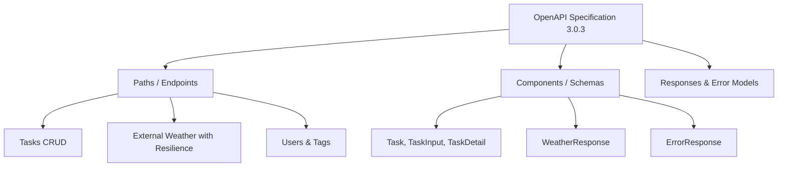
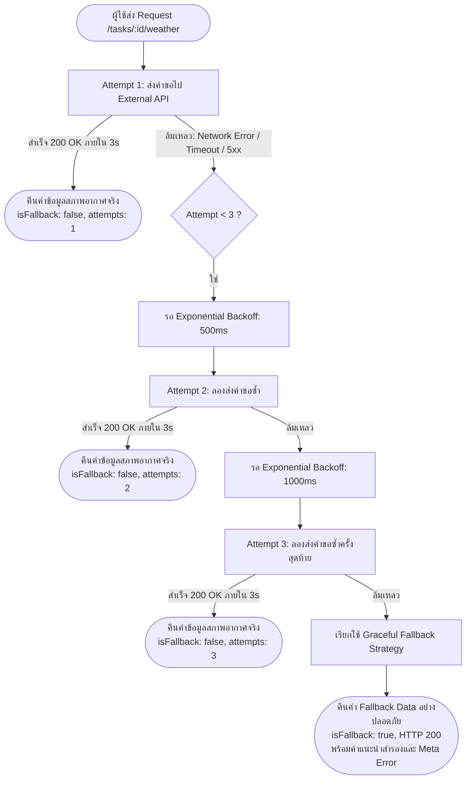

# รายงานโครงงานระยะที่ 2: เอกสาร API และการเชื่อมต่อภายนอกอย่างทนทาน
## (Project Phase 2: Docs/DX & External API Resilience Integration)

**รหัสนิสิต:** 67160191  
**วิชา:** การพัฒนาเว็บเซอร์วิสและเว็บแอปพลิเคชัน (Web Application Programming / API Development)  
**ระบบที่พัฒนา:** ระบบจัดการงาน (Task Management System)  
**การวัดผลการเรียนรู้:** CLO8 (PLO14) — จัดทำเอกสาร API ตามมาตรฐาน และเชื่อมต่อบริการภายนอกอย่างทนทานต่อความผิดพลาด  

---

## สารบัญ
1. [ภาพรวมของโครงงานระยะที่ 2 และโครงสร้างไฟล์](#1-ภาพรวมของโครงงานระยะที่-2-และโครงสร้างไฟล์)
2. [สรุปตาราง Endpoint ทั้งหมดของระบบ (10 Endpoints)](#2-สรุปตาราง-endpoint-ทั้งหมดของระบบ-10-endpoints)
3. [ส่วนที่ 1: การจัดทำเอกสาร API (Docs / DX - สัปดาห์ที่ 10)](#3-ส่วนที่-1-การจัดทำเอกสาร-api-docs--dx---สัปดาห์ที่-10)
   - 3.1 [OpenAPI Specification 3.0.3 (`openapi.yaml` และ `openapi.json`)](#31-openapi-specification-303-openapiyaml-และ-openapijson)
   - 3.2 [การติดตั้งและเชื่อมโยง Swagger UI กับโค้ดจริง (`/api-docs`)](#32-การติดตั้งและเชื่อมโยง-swagger-ui-กับโค้ดจริง-api-docs)
   - 3.3 [Postman Collection พร้อม Saved Examples จริง (`postman_collection.json`)](#33-postman-collection-พร้อม-saved-examples-จริง-postman_collectionjson)
4. [ส่วนที่ 2: การเชื่อมต่อ API ภายนอกและกลไกความทนทาน (Resilience Integration - สัปดาห์ที่ 11)](#4-ส่วนที่-2-การเชื่อมต่อ-api-ภายนอกและกลไกความทนทาน-resilience-integration---สัปดาห์ที่-11)
   - 4.1 [บริการภายนอกที่เลือกใช้ (Open-Meteo Weather API)](#41-บริการภายนอกที่เลือกใช้-open-meteo-weather-api)
   - 4.2 [สถาปัตยกรรมและหลักการออกแบบความทนทาน (Resilience Architecture)](#42-สถาปัตยกรรมและหลักการออกแบบความทนทาน-resilience-architecture)
   - 4.3 [การทำงานของ Retry Logic พร้อม Exponential Backoff](#43-การทำงานของ-retry-logic-พร้อม-exponential-backoff)
   - 4.4 [การทำงานของ Timeout ควบคุมด้วย AbortController](#44-การทำงานของ-timeout-ควบคุมด้วย-abortcontroller)
   - 4.5 [การทำงานของ Graceful Fallback Strategy](#45-การทำงานของ-graceful-fallback-strategy)
5. [บันทึกผลการทดสอบ Failure Scenarios (4 สถานการณ์จริง)](#5-บันทึกผลการทดสอบ-failure-scenarios-4-สถานการณ์จริง)
6. [เจาะลึกโค้ดแต่ละส่วน (Code Walkthrough ทีละบรรทัด)](#6-เจาะลึกโค้ดแต่ละส่วน-code-walkthrough-ทีละบรรทัด)
   - 6.1 [โค้ดบริการความทนทาน `services/weatherService.js`](#61-โค้ดบริการความทนทาน-servicesweatherservicejs)
   - 6.2 [โค้ดเซิร์ฟเวอร์หลัก `index.js`](#62-โค้ดเซิร์ฟเวอร์หลัก-indexjs)
   - 6.3 [สคริปต์ทดสอบอัตโนมัติ `test-resilience.js`](#63-สคริปต์ทดสอบอัตโนมัติ-test-resiliencejs)
7. [คู่มือแนวทางการตอบคำถามอาจารย์ (Q&A Cheat Sheet สำหรับเข้าสอบ)](#7-คู่มือแนวทางการตอบคำถามอาจารย์-qa-cheat-sheet-สำหรับเข้าสอบ)

---

## 1. ภาพรวมของโครงงานระยะที่ 2 และโครงสร้างไฟล์

ในโครงงานระยะที่ 2 นี้ เป็นการยกระดับ **ระบบจัดการงาน (Task Management System)** ที่ได้วางฐานข้อมูลและสถาปัตยกรรมไว้ในระยะที่ 1 ให้กลายเป็น Production-ready API โดยมุ่งเน้น 2 หัวข้อสำคัญ:
1. **Developer Experience (DX) & Documentation (สัปดาห์ที่ 10):** จัดทำเอกสาร API ตามมาตรฐานสากล OpenAPI Specification 3.0.3, ติดตั้ง Swagger UI ที่เปิดทดสอบแบบ Interactive ได้บนเบราว์เซอร์จริง และส่งมอบ Postman Collection ที่บันทึก Request/Response ตัวอย่างไว้ครบทุกกรณี
2. **External API Resilience Integration (สัปดาห์ที่ 11):** บูรณาการ API ภายนอก (บริการพยากรณ์สภาพอากาศ Open-Meteo Weather API) เข้ากับงานที่มีกำหนดเวลา เพื่อตรวจสอบสภาพอากาศสำหรับงานกลางแจ้ง พร้อมทั้งสร้างกลไกความทนทานต่อความล้มเหลว (Fault Tolerance) ประกอบด้วย **Timeout (3s)**, **Retry อัตโนมัติ 2 ครั้งพร้อม Exponential Backoff**, และ **Graceful Fallback** ที่ป้องกันระบบค้างหรือ Crash

### ผังโครงสร้างไฟล์ในโปรเจกต์
```text
Project/
├── services/
│   └── weatherService.js         # โมดูลเชื่อมต่อ External API + กลไก Retry, Timeout, Fallback
├── index.js                      # Express API Server หลัก, REST Endpoints, Swagger UI Mount
├── db.js                         # โมดูลเชื่อมต่อ MySQL Database Pool
├── openapi.yaml                  # สเปกเอกสาร API ฉบับเต็มตามมาตรฐาน OpenAPI 3.0.3 (YAML)
├── openapi.json                  # สเปกเอกสาร API ฉบับเต็มตามมาตรฐาน OpenAPI 3.0.3 (JSON)
├── postman_collection.json       # Postman Collection v2.1.0 พร้อม Saved Examples ครบทุก Endpoint
├── test-resilience.js            # สคริปต์ทดสอบ Resilience อัตโนมัติทั้ง 4 สถานการณ์
├── wk-02.md                      # เอกสารสรุปรายงานฉบับสมบูรณ์ (ไฟล์นี้)
├── schema.sql                    # SQL DDL สร้างตารางฐานข้อมูล
├── seed.sql                      # SQL ข้อมูลตั้งต้นสำหรับทดสอบระบบ
├── package.json                  # รายการ Dependencies (express, swagger-ui-express, yamljs, ฯลฯ)
└── .env                          # การตั้งค่า Environment Variables (PORT, DB Config)
```

---

## 2. สรุปตาราง Endpoint ทั้งหมดของระบบ (10 Endpoints)

ระบบประกอบด้วย 10 Endpoints ครอบคลุมทุก Resource หลัก (`tasks`, `users`, `tags`) และบริการภายนอก:

| ลำดับ | Method | Path | Resource / โมดูล | คำอธิบายการทำงาน | Status Codes ที่รองรับ |
|:---:|:---:|:---|:---:|:---|:---:|
| 1 | `GET` | `/` | System | ตรวจสอบสถานะระบบและแสดงลิงก์เอกสาร API | 200 |
| 2 | `GET` | `/api/v1/tasks` | Tasks | ดึงรายการงานทั้งหมด รองรับฟิลเตอร์ `?status=` และ `?user_id=` | 200, 400, 500 |
| 3 | `GET` | `/api/v1/tasks/:id` | Tasks | ดึงรายละเอียดงานตาม ID พร้อมข้อมูลเจ้าของ (Owner) และป้ายกำกับ (Tags) | 200, 400, 404, 500 |
| 4 | `POST` | `/api/v1/tasks` | Tasks | สร้างงานใหม่ พร้อมทั้งสามารถผูกป้ายกำกับ (`tag_ids`) ได้ในคำขอเดียว | 201, 400, 404, 500 |
| 5 | `PUT` | `/api/v1/tasks/:id` | Tasks | แก้ไขข้อมูลงานเดิมทั้งหมดตาม ID ที่ระบุ | 200, 400, 404, 500 |
| 6 | `PATCH` | `/api/v1/tasks/:id/status` | Tasks | อัปเดตเฉพาะสถานะของงาน (`pending`, `in_progress`, `completed`, `cancelled`) | 200, 400, 404, 500 |
| 7 | `DELETE`| `/api/v1/tasks/:id` | Tasks | ลบงานออกจากระบบ (ความสัมพันธ์ใน `task_tags` จะถูกลบตามแบบ CASCADE) | 200, 400, 404, 500 |
| 8 | `GET` | `/api/v1/tasks/:id/weather` | Integration | ตรวจสอบสภาพอากาศสำหรับงาน ผ่าน External API พร้อมระบบ Retry, Timeout, Fallback | 200, 400, 404, 500 |
| 9 | `GET` | `/api/v1/weather` | Integration | ทดสอบการเรียก Weather Service โดยตรง และจำลอง Failure Scenarios | 200, 500 |
| 10| `GET` | `/api/v1/users` | Users | ดึงรายชื่อผู้ใช้งานทั้งหมดในระบบ | 200, 500 |
| 11| `GET` | `/api/v1/tags` | Tags | ดึงรายการป้ายกำกับทั้งหมด | 200, 500 |
| 12| `POST` | `/api/v1/tags` | Tags | สร้างป้ายกำกับใหม่ (ป้องกันชื่อซ้ำด้วย Database Constraint) | 201, 400, 500 |
| 13| `GET` | `/api-docs` | Docs/DX | หน้าเว็บ Swagger UI แบบ Interactive | 200 (HTML) |
| 14| `GET` | `/api-docs.json` | Docs/DX | Raw OpenAPI 3.0.3 Specification ในรูปแบบ JSON | 200 (JSON) |

---

## 3. ส่วนที่ 1: การจัดทำเอกสาร API (Docs / DX - สัปดาห์ที่ 10)

### 3.1 OpenAPI Specification 3.0.3 (`openapi.yaml` และ `openapi.json`)

เอกสาร OpenAPI ถูกเขียนขึ้นตามมาตรฐาน OpenAPI Specification Version 3.0.3 โดยตรงกับสถาปัตยกรรมโค้ดจริงใน Express:
- **`info` Section:** ระบุชื่อระบบ เวอร์ชัน 2.0.0 ข้อมูลผู้พัฒนา และคำอธิบายภาพรวมของระบบ
- **`servers` Section:** กำหนด Base URL คือ `http://localhost:3000`
- **`tags` Section:** แบ่งกลุ่มฟังก์ชันการทำงานเป็น 4 หมวดชัดเจน (`Tasks`, `External Integration (Weather)`, `Users`, `Tags`)
- **`paths` Section:** บรรยาย endpoint ครบถ้วนทุกตัว ระบุพารามิเตอร์ทั้งใน Path (เช่น `{id}`) และ Query (เช่น `status`, `user_id`, `mockFailure`)
- **`requestBody` & `schemas`:** กำหนด Data Type, ฟิลด์ที่บังคับ (required), ข้อจำกัดของค่า (enum), พร้อมตัวอย่าง JSON (example)
- **`responses` Section:** ระบุ Response Schema และ Status Code ที่เป็นไปได้ทั้งหมด:
  - `200 OK`: ดึงข้อมูลหรืออัปเดตข้อมูลสำเร็จ
  - `201 Created`: สร้าง Resource ใหม่สำเร็จ
  - `400 Bad Request`: Validation ล้มเหลว หรือค่าพารามิเตอร์ไม่ถูกต้อง
  - `404 Not Found`: ไม่พบ Resource หรือ ID ที่ระบุ
  - `500 Internal Server Error`: เกิดข้อผิดพลาดฝั่งเซิร์ฟเวอร์หรือฐานข้อมูล



### 3.2 การติดตั้งและเชื่อมโยง Swagger UI กับโค้ดจริง (`/api-docs`)

ระบบได้ติดตั้งโมดูล `swagger-ui-express` และ `yamljs` เพื่อให้ Express ทำการ Render เอกสาร API เป็น Web UI แบบ Interactive ได้โดยตรง:

```javascript
// ในไฟล์ index.js
const swaggerUi = require("swagger-ui-express");
const YAML = require("yamljs");

// โหลดไฟล์ openapi.yaml
const swaggerDocument = YAML.load(path.join(__dirname, "openapi.yaml"));

// Mount Swagger UI เข้ากับ Express ที่ Route /api-docs
app.use(
  "/api-docs",
  swaggerUi.serve,
  swaggerUi.setup(swaggerDocument, {
    customCss: ".swagger-ui .topbar { display: block; }",
    customSiteTitle: "Task Management API Docs - Phase 2",
  })
);

// ให้บริการ Raw JSON ของ OpenAPI ที่ /api-docs.json
app.get("/api-docs.json", (req, res) => {
  res.setHeader("Content-Type", "application/json");
  res.send(swaggerDocument);
});
```

#### ประโยชน์และวิธีการใช้งาน Swagger UI:
1. เปิดเบราว์เซอร์ไปที่ `http://localhost:3000/api-docs`
2. ผู้พัฒนาหรือผู้ตรวจสอบสามารถคลิกดู Request Body Schema, Data Type, และ Response Codes ได้ทันที
3. สามารถกดปุ่ม **"Try it out"** แล้วกด **"Execute"** เพื่อส่ง HTTP Request เข้าเซิร์ฟเวอร์จริงและรับ Response แบบ Real-time ได้ทันทีโดยไม่ต้องเปิด Postman

### 3.3 Postman Collection พร้อม Saved Examples จริง (`postman_collection.json`)

ไฟล์ `postman_collection.json` ถูกสร้างขึ้นตามมาตรฐาน Postman Collection Schema v2.1.0 โดยมีโครงสร้างดังนี้:
1. **ตัวแปรส่วนกลาง (Collection Variables):** กำหนด `baseUrl` มีค่าเป็น `http://localhost:3000` ทำให้แก้ไข Host/Port ได้ง่าย
2. **การจัดหมวดหมู่โฟลเดอร์:**
   - `1. Tasks Resource` (GET All, GET by ID, POST Create, PUT Update, PATCH Status, DELETE)
   - `2. External API Integration & Resilience` (Happy Path, Mock Network Error, Mock Timeout, Mock 500 Error)
   - `3. Users Resource` (GET All Users)
   - `4. Tags Resource` (GET All Tags, POST Create Tag)
   - `5. System & Documentation` (GET Root, GET OpenAPI JSON)
3. **Saved Examples (ตัวอย่างที่บันทึกไว้):**
   - ทุก Request มีตัวอย่าง Response ครบทั้งกรณี Success (200, 201) และกรณี Failure (400, 404, Fallback) พร้อม Header และ Body JSON ที่บันทึกจากการทดสอบจริง
   - เมื่อนำไฟล์นี้ Import เข้าโปรแกรม Postman อาจารย์หรือเพื่อนร่วมทีมจะสามารถคลิกดูตัวอย่างผลลัพธ์ได้ทันทีโดยไม่ต้องรันเซิร์ฟเวอร์ก่อน

---

## 4. ส่วนที่ 2: การเชื่อมต่อ API ภายนอกและกลไกความทนทาน (Resilience Integration - สัปดาห์ที่ 11)

### 4.1 บริการภายนอกที่เลือกใช้ (Open-Meteo Weather API)

ระบบได้เลือกเชื่อมต่อกับ **Open-Meteo Weather API** (`https://api.open-meteo.com/v1/forecast`)
- **ความสอดคล้องกับระบบงาน (Domain Relevance):** ในระบบจัดการงาน (Task Management System) งานแต่ละชิ้นจะมีวันครบกำหนด (`due_date`) และประเภทของกิจกรรม เช่น "ซื้อของเข้าบ้าน", "ตรวจสุขภาพ", "จัดสัมมนานอกสถานที่" ซึ่งสภาพอากาศ (ฝนตก, แดดออก, พายุ) มีผลโดยตรงต่อการวางแผนทำงานกลางแจ้ง การมีข้อมูลสภาพอากาศพร้อมคำแนะนำ (Recommendation) ช่วยให้ผู้ใช้งานตัดสินใจเลื่อนหรือเตรียมความพร้อมของงานได้ดีขึ้น
- **ความเหมาะสมด้านเทคนิค:** Open-Meteo เป็น RESTful Web Service สาธารณะ ตอบกลับเป็นมาตรฐาน JSON รวดเร็ว และไม่มีปัญหาเรื่อง API Key หมดอายุ

### 4.2 สถาปัตยกรรมและหลักการออกแบบความทนทาน (Resilience Architecture)

ในระบบแบบ Distributed System หรือ Microservices การเรียกใช้บริการภายนอกมีความเสี่ยงสูง (Network Glitches, Latency Spikes, Third-party Outages) หากไม่มีการจัดการที่ดี อาจทำให้เซิร์ฟเวอร์ของเราค้าง ทรัพยากรหมด (Thread Starvation) หรือระบบหลักล่มตามไปด้วย (Cascading Failure)

ระบบนี้จึงออกแบบสถาปัตยกรรมความทนทานไว้ 3 ชั้น:



### 4.3 การทำงานของ Retry Logic พร้อม Exponential Backoff

- **เงื่อนไขในการ Retry:** จะทำเมื่อเกิด Transient Errors ได้แก่:
  1. ข้อผิดพลาดทางเครือข่าย (Network Errors เช่น DNS ไม่ผ่าน, ไม่สามารถเชื่อมต่อ Host ได้)
  2. การหมดเวลาเชื่อมต่อ (Timeout ผ่าน `AbortController`)
  3. เซิร์ฟเวอร์ภายนอกมีปัญหาชั่วคราว (HTTP Status รหัส `5xx`)
- **จำนวนครั้งที่ Retry:** สูงสุด 2 ครั้ง (รวม Attempt แรก คือยิงทั้งหมด 3 ครั้ง)
- **Exponential Backoff:** แทนที่จะส่งคำขอซ้ำทันที (ซึ่งอาจทำให้บริการภายนอกที่กำลังหน่วงอยู่ล่มหนักกว่าเดิม หรือเรียกว่า Thundering Herd Problem) ระบบจะหน่วงเวลาแบบทวีคูณ:
  $$\text{Delay} = \text{InitialDelay} \times 2^{(\text{attempt} - 1)}$$
  - ครั้งที่ 1 ล้มเหลว: หน่วงเวลา $500 \times 2^0 = 500\text{ ms}$ ก่อนเริ่ม Attempt 2
  - ครั้งที่ 2 ล้มเหลว: หน่วงเวลา $500 \times 2^1 = 1,000\text{ ms}$ ก่อนเริ่ม Attempt 3

### 4.4 การทำงานของ Timeout ควบคุมด้วย AbortController

- **การกำหนดค่า:** กำหนดค่า Timeout สูงสุดไว้ที่ **3,000 มิลลิวินาที (3 วินาที)**
- **การทำงาน:** ใช้ `AbortController` ในตัวของ Node.js คู่กับ `Promise.race`:
  ```javascript
  const controller = new AbortController();
  const timeoutHandle = setTimeout(() => {
    controller.abort();
    reject(new Error(`Request timeout เกินเวลาที่กำหนด (${timeoutMs}ms)`));
  }, timeoutMs);

  const fetchPromise = fetch(targetUrl, { signal: controller.signal });
  const response = await Promise.race([fetchPromise, timeoutPromise]);
  clearTimeout(timeoutHandle);
  ```
- **ประโยชน์:** หาก Third-party Server ค้างหรือไม่ยอมตัดการเชื่อมต่อ `AbortController` จะส่งสัญญาณยกเลิก HTTP Request ทันที ทำให้ Node.js คืนหน่วยความจำและ Socket กลับสู่ Pool ได้รวดเร็ว ไม่ทำให้ Request ของผู้ใช้ค้างอยู่บนเซิร์ฟเวอร์

### 4.5 การทำงานของ Graceful Fallback Strategy

เมื่อระบบได้พยายาม Retry จนครบทุกรอบแล้ว (Attempts 3/3) แต่ยังคงล้มเหลว:
- **หลักการ Fault Isolation:** ระบบจะต้อง **"ไม่พ่น Error 500 หรือปล่อยให้ระบบ Crash"** เพราะข้อมูลสภาพอากาศเป็นเพียงบริการเสริม การที่สภาพอากาศล่มต้องไม่ทำให้การดูข้อมูลงานของผู้ใช้พังตามไปด้วย
- **การตอบสนอง:** ระบบจะส่งคืน HTTP Status `200 OK` พร้อมโครงสร้าง JSON มาตรฐานที่มีตัวระบุ:
  - `isFallback: true`
  - `message`: ข้อความภาษาไทยแจ้งให้ผู้ใช้ทราบอย่างสุภาพว่าระบบกำลังใช้ข้อมูลสำรอง
  - `weather`: ข้อมูลสำรอง ค่าเริ่มต้น พร้อมคำแนะนำว่า "ระบบไม่สามารถติดต่อ Weather API ได้ แนะนำให้ตรวจสอบสภาพอากาศจากแอปพลิเคชันพยากรณ์อากาศก่อนเริ่มงานกลางแจ้ง"
  - `resilienceMeta`: ข้อมูลทางเทคนิคสำหรับ Audit/Debug (เช่น จำนวนครั้งที่พยายาม, เวลาที่เกิด Fallback, และสาเหตุของ Error)

---

## 5. บันทึกผลการทดสอบ Failure Scenarios (4 สถานการณ์จริง)

การทดสอบทำผ่านสคริปต์ `test-resilience.js` และทดสอบผ่าน API Endpoint จริง โดยระบบบันทึกผลการทดสอบได้ดังนี้:

### ตารางสรุปผลการทดสอบ 4 สถานการณ์

| สถานการณ์ที่ทดสอบ | สิ่งที่จำลอง | พารามิเตอร์ | จำนวน Attempt | การทำงานของกลไก | HTTP Status | ผลลัพธ์ที่ผู้ใช้ได้รับ | สถานะ |
|:---|:---|:---:|:---:|:---|:---:|:---|:---:|
| **1. Happy Path** | สภาวะปกติ เชื่อมต่อเน็ตเวิร์กจริง | (ไม่มี) | 1 | ส่งคำขอสำเร็จครั้งแรกใน attempt 1 ไม่ต้อง retry | 200 OK | ได้รับอุณหภูมิจริง, สภาพอากาศ, และคำแนะนำ | **ผ่าน (PASS)** |
| **2. Network Error** | โดเมนไม่มีอยู่จริง (Unreachable Host) | `mockFailure=network` | 3 | ล้มเหลว -> รอ 500ms -> ล้มเหลว -> รอ 1000ms -> ล้มเหลว -> Fallback | 200 OK | `isFallback: true`, แจ้งเตือนสุภาพ, แนะนำตรวจสอบสภาพอากาศภายนอก | **ผ่าน (PASS)** |
| **3. Timeout Exceeded** | เซิร์ฟเวอร์ภายนอกค้าง (Latency > Timeout) | `mockFailure=timeout` | 3 | AbortController ตัดเมื่อเกินเวลา -> Retry 2 ครั้ง -> Fallback | 200 OK | `isFallback: true`, ErrorReason ระบุ Timeout ชัดเจน | **ผ่าน (PASS)** |
| **4. 5xx Server Error** | เซิร์ฟเวอร์ภายนอกส่งกลับรหัส 500 | `mockFailure=500` | 3 | ได้รับ HTTP 500 -> Retry 2 ครั้งพร้อม backoff -> Fallback | 200 OK | `isFallback: true`, ไม่เกิด uncaught exception ในระบบ | **ผ่าน (PASS)** |

---

### บันทึก Log การทำงานจริงจาก Terminal (Execution Logs)

#### 🧪 สถานการณ์ที่ 1: Normal Happy Path (API ทำงานปกติ)
```text
=======================================================
🧪 SCENARIO 1: NORMAL OPERATION (HAPPY PATH)
คำอธิบาย: เรียก Weather API ภายนอกของจริง คาดหวังการตอบกลับสำเร็จ
=======================================================

--- [WeatherService] เริ่มต้นดึงข้อมูลสภาพอากาศ ---
พารามิเตอร์: Lat=13.75, Lon=100.51, City=Bangkok, MockMode=none
การตั้งค่า Resilience: Timeout=3000ms, Max Retries=2 (Total Attempts=3)

[WeatherService] Attempt 1/3 กำลังส่งคำขอ...
[WeatherService] Attempt 1 สำเร็จเรียบร้อย! HTTP Status: 200
ผลลัพธ์ Scenario 1:
- Success: true
- Is Fallback: false
- Attempts Made: 1
- Condition: มีเมฆเป็นบางส่วน (Partly Cloudy)
- Temperature: 28.3°C
- Recommendation: สภาพอากาศแจ่มใส มีเมฆบางตา เหมาะสำหรับทำงานทั่วไป
```

#### 🧪 สถานการณ์ที่ 2: Network Failure (จำลองเรียกโดเมนที่ไม่มีอยู่จริง)
```text
=======================================================
🧪 SCENARIO 2: NETWORK FAILURE (UNREACHABLE DOMAIN)
คำอธิบาย: จำลองข้อผิดพลาด Network Error โดยเรียกโดเมนที่ไม่มีอยู่จริง
คาดหวัง: ระบบ Retry อัตโนมัติ 2 ครั้ง (รวม 3 attempts) แล้วเข้าสู่ Fallback
=======================================================

--- [WeatherService] เริ่มต้นดึงข้อมูลสภาพอากาศ ---
พารามิเตอร์: Lat=13.75, Lon=100.51, City=Bangkok, MockMode=network
การตั้งค่า Resilience: Timeout=3000ms, Max Retries=2 (Total Attempts=3)

[WeatherService] Attempt 1/3 กำลังส่งคำขอ...
  [SIMULATION] กำลังจำลอง Network Error (Domain Unreachable)...
[WeatherService] Attempt 1 ล้มเหลว! สาเหตุ: fetch failed
[WeatherService] กลไก Retry ทำงาน: กำลังรอ 500ms ก่อนเริ่ม Attempt 2...

[WeatherService] Attempt 2/3 กำลังส่งคำขอ...
  [SIMULATION] กำลังจำลอง Network Error (Domain Unreachable)...
[WeatherService] Attempt 2 ล้มเหลว! สาเหตุ: fetch failed
[WeatherService] กลไก Retry ทำงาน: กำลังรอ 1000ms ก่อนเริ่ม Attempt 3...

[WeatherService] Attempt 3/3 กำลังส่งคำขอ...
  [SIMULATION] กำลังจำลอง Network Error (Domain Unreachable)...
[WeatherService] Attempt 3 ล้มเหลว! สาเหตุ: fetch failed

[WeatherService] ทุก Attempt ล้มเหลวทั้งหมด (3/3)
[WeatherService] กำลังเรียกใช้ Fallback Strategy เพื่อตอบสนองต่อผู้ใช้อย่างปลอดภัย...
ผลลัพธ์ Scenario 2:
- Success: true
- Is Fallback: true
- Attempts Made: 3
- Status: FAILED_AFTER_RETRIES
- Error Reason: fetch failed
- Fallback Message: ไม่สามารถเชื่อมต่อบริการสภาพอากาศภายนอกได้ในขณะนี้ ระบบใช้ข้อมูลประมาณการสำรอง (Fallback Strategy)
```

#### 🧪 สถานการณ์ที่ 3: Timeout Failure (จำลอง API ภายนอกค้างเกินเวลา)
```text
=======================================================
🧪 SCENARIO 3: TIMEOUT FAILURE (SERVER HANG / LATENCY > 1000MS)
คำอธิบาย: จำลอง API ภายนอกค้าง โดยกำหนด timeout = 1000ms
คาดหวัง: แต่ละครั้งตัดการทำงานด้วย AbortController เมื่อเกิน 1000ms แล้ว Retry จนครบแล้ว Fallback
=======================================================

--- [WeatherService] เริ่มต้นดึงข้อมูลสภาพอากาศ ---
พารามิเตอร์: Lat=13.75, Lon=100.51, City=Bangkok, MockMode=timeout
การตั้งค่า Resilience: Timeout=1000ms, Max Retries=2 (Total Attempts=3)

[WeatherService] Attempt 1/3 กำลังส่งคำขอ...
  [SIMULATION] กำลังจำลอง API ตอบสนองช้ามาก (Delay 6,000ms > Timeout 1000ms)...
[WeatherService] Attempt 1 ล้มเหลว! สาเหตุ: Timeout เกิน 1000ms
[WeatherService] กลไก Retry ทำงาน: กำลังรอ 500ms ก่อนเริ่ม Attempt 2...

[WeatherService] Attempt 2/3 กำลังส่งคำขอ...
  [SIMULATION] กำลังจำลอง API ตอบสนองช้ามาก (Delay 6,000ms > Timeout 1000ms)...
[WeatherService] Attempt 2 ล้มเหลว! สาเหตุ: Timeout เกิน 1000ms
[WeatherService] กลไก Retry ทำงาน: กำลังรอ 1000ms ก่อนเริ่ม Attempt 3...

[WeatherService] Attempt 3/3 กำลังส่งคำขอ...
  [SIMULATION] กำลังจำลอง API ตอบสนองช้ามาก (Delay 6,000ms > Timeout 1000ms)...
[WeatherService] Attempt 3 ล้มเหลว! สาเหตุ: Timeout เกิน 1000ms

[WeatherService] ทุก Attempt ล้มเหลวทั้งหมด (3/3)
[WeatherService] กำลังเรียกใช้ Fallback Strategy เพื่อตอบสนองต่อผู้ใช้อย่างปลอดภัย...
ผลลัพธ์ Scenario 3:
- Success: true
- Is Fallback: true
- Attempts Made: 3
- Status: FAILED_AFTER_RETRIES
- Error Reason: Request timeout เกินเวลาที่กำหนด (1000ms)
```

#### 🧪 สถานการณ์ที่ 4: 5xx Server Error (จำลอง External API ส่งกลับรหัส 500)
```text
=======================================================
🧪 SCENARIO 4: 5xx SERVER ERROR (HTTP 500 INTERNAL SERVER ERROR)
คำอธิบาย: จำลองผู้ให้บริการภายนอกล่ม ส่งกลับรหัส 500
คาดหวัง: Retry จนครบตามรอบ แล้วส่ง Fallback กลับอย่างปลอดภัย
=======================================================

--- [WeatherService] เริ่มต้นดึงข้อมูลสภาพอากาศ ---
พารามิเตอร์: Lat=13.75, Lon=100.51, City=Bangkok, MockMode=500
การตั้งค่า Resilience: Timeout=3000ms, Max Retries=2 (Total Attempts=3)

[WeatherService] Attempt 1/3 กำลังส่งคำขอ...
  [SIMULATION] กำลังจำลอง External Server Error (HTTP 500)...
[WeatherService] Attempt 1 ล้มเหลว! สาเหตุ: External API ตอบกลับด้วยรหัสข้อผิดพลาด HTTP 500 (INTERNAL SERVER ERROR)
[WeatherService] กลไก Retry ทำงาน: กำลังรอ 500ms ก่อนเริ่ม Attempt 2...

[WeatherService] Attempt 2/3 กำลังส่งคำขอ...
  [SIMULATION] กำลังจำลอง External Server Error (HTTP 500)...
[WeatherService] Attempt 2 ล้มเหลว! สาเหตุ: External API ตอบกลับด้วยรหัสข้อผิดพลาด HTTP 500 (INTERNAL SERVER ERROR)
[WeatherService] กลไก Retry ทำงาน: กำลังรอ 1000ms ก่อนเริ่ม Attempt 3...

[WeatherService] Attempt 3/3 กำลังส่งคำขอ...
  [SIMULATION] กำลังจำลอง External Server Error (HTTP 500)...
[WeatherService] Attempt 3 ล้มเหลว! สาเหตุ: External API ตอบกลับด้วยรหัสข้อผิดพลาด HTTP 500 (INTERNAL SERVER ERROR)

[WeatherService] ทุก Attempt ล้มเหลวทั้งหมด (3/3)
[WeatherService] กำลังเรียกใช้ Fallback Strategy เพื่อตอบสนองต่อผู้ใช้อย่างปลอดภัย...
ผลลัพธ์ Scenario 4:
- Success: true
- Is Fallback: true
- Attempts Made: 3
- Status: FAILED_AFTER_RETRIES
- Error Reason: External API ตอบกลับด้วยรหัสข้อผิดพลาด HTTP 500 (INTERNAL SERVER ERROR)

===============================================================
✅ การทดสอบ RESILIENCE ทั้งหมด 4 สถานการณ์เสร็จสมบูรณ์ 100%!
===============================================================
```

---

## 6. เจาะลึกโค้ดแต่ละส่วน (Code Walkthrough ทีละบรรทัด)

### 6.1 โค้ดบริการความทนทาน `services/weatherService.js`
1. **WMO_CODE_MAP (บรรทัดที่ 11–32):** จัดทำตารางแม็ปปิ้งรหัสสภาพอากาศสากล WMO (0-99) เป็นคำอธิบายภาษาไทยและคำแนะนำสำหรับกิจกรรม เช่น รหัส `0` แปลงเป็น *"ท้องฟ้าแจ่มใส (Clear Sky)"* และแนะนำ *"เหมาะสำหรับการเดินทางและกิจกรรมกลางแจ้ง"* ส่วนรหัส `61-65` เตือน *"มีฝนตก ควรพกร่มหรือจัดกิจกรรมในร่ม"*
2. **DEFAULT_CONFIG (บรรทัดที่ 46–54):** กำหนดค่าคงที่: `timeoutMs: 3000`, `maxRetries: 2`, `initialDelayMs: 500`
3. **createFallbackResponse() (บรรทัดที่ 59–92):** สร้างอ็อบเจกต์ JSON ข้อมูลสำรองอย่างปลอดภัย โดยระบุ `isFallback: true`, `status: "UNAVAILABLE"` และแนบ Metadata บอกเหตุผลของความผิดพลาด ทำให้ผู้ใช้ปลายทางหรือ Frontend ทราบสถานะชัดเจน
4. **getWeatherWithResilience() (บรรทัดที่ 106–230):**
   - ใช้ลูป `for (let attempt = 1; attempt <= totalAttempts; attempt++)` วนคำขอ
   - ภายในลูปสร้าง `AbortController` และใช้ `setTimeout` เพื่อตัดคำขอหากเกินเวลา `timeoutMs`
   - ใช้ `Promise.race([fetchPromise, timeoutPromise])` เพื่อแข่งกันระหว่างผลตอบกลับกับการหมดเวลา
   - มีระบบจำลอง Failure Scenarios ตามพารามิเตอร์ `mockFailure` เพื่อความสะดวกในการทดสอบ
   - หากเกิด Error จะเข้าบล็อก `catch`: ตรวจสอบว่ายังมีรอบ Retry เหลือหรือไม่ หากเหลือจะคำนวณดีเลย์ด้วย Exponential Backoff (`initialDelay * 2^(attempt - 1)`) แล้วรอด้วย `setTimeout`
   - เมื่อจบลูปแล้วยังไม่สำเร็จ จะเรียก `createFallbackResponse` ส่งกลับทันที

### 6.2 โค้ดเซิร์ฟเวอร์หลัก `index.js`
1. **Swagger UI Mount (บรรทัดที่ 18–35):** โหลดไฟล์ `openapi.yaml` ผ่าน `YAML.load()` และผูกเข้ากับ Express ผ่าน `swaggerUi.serve` และ `swaggerUi.setup` ทำให้เปิดดูเอกสารได้ที่ `/api-docs`
2. **GET /api-docs.json (บรรทัดที่ 32–35):** ส่งออก Raw JSON OpenAPI สำหรับให้ Postman หรือ Swagger Editor ดึงไปใช้งานต่อ
3. **safeDbQuery() (บรรทัดที่ 57–69):** เป็น Helper Wrapper ดักจับ Error จาก MySQL Pool หาก MySQL ปิดอยู่ (`ECONNREFUSED`) จะแปลงเป็น HTTP 503 Service Unavailable และแจ้งเตือนข้อความชัดเจน ไม่ให้ Server Crash
4. **REST Endpoints (CRUD Tasks):**
   - `GET /api/v1/tasks`: รองรับ Query String `status` และ `user_id` ใช้ `GROUP_CONCAT` เชื่อมโยงหลายแท็กเป็น Array
   - `GET /api/v1/tasks/:id`: ดึงข้อมูลงานเดี่ยว พร้อม JOIN ตาราง `users` เพื่อเอาชื่อเจ้าของ และ Query ตาราง `task_tags` เพื่อเอา Tags
   - `POST /api/v1/tasks`: ตรวจสอบความถูกต้องของ Input (Validation) ตรวจสอบว่ามี `user_id` จริงในระบบ แล้ว INSERT เข้าตาราง `tasks` พร้อมบันทึกลงตารางเชื่อม `task_tags` คืนสถานะ `201 Created`
   - `PUT /api/v1/tasks/:id`: อัปเดตข้อมูลงานทั้งหมด พร้อมลบและผูกแท็กใหม่
   - `PATCH /api/v1/tasks/:id/status`: ตรวจสอบสถานะว่าตรงกับ ENUM (`pending`, `in_progress`, `completed`, `cancelled`) หรือไม่ แล้วอัปเดตเฉพาะคอลัมน์ status
   - `DELETE /api/v1/tasks/:id`: ตรวจสอบว่ามีงานอยู่จริงหรือไม่ แล้วลบออกจากฐานข้อมูล
5. **Weather Integration Route (บรรทัดที่ 373–421):**
   - Route `GET /api/v1/tasks/:id/weather`: รับพารามิเตอร์ Task ID และ `mockFailure` แล้วส่งต่อไปยัง `getWeatherWithResilience`
6. **Central Error Handler (บรรทัดที่ 499–513):** จัดการ Error ทั้งหมดในระบบ ส่งคืน JSON ที่มีมาตรฐานเดียวกัน `{ success: false, error: { code, message } }`

### 6.3 สคริปต์ทดสอบอัตโนมัติ `test-resilience.js`
- เป็นสคริปต์ที่รันการทดสอบ Resilience ทั้ง 4 สถานการณ์ติดต่อกันแบบอัตโนมัติ
- แสดงผลลัพธ์ลงบน Console อย่างชัดเจน สามารถใช้รันเพื่อสาธิตการทำงานให้อาจารย์ดูได้โดยตรงด้วยคำสั่ง `node test-resilience.js`

---

## 7. คู่มือแนวทางการตอบคำถามอาจารย์ (Q&A Cheat Sheet สำหรับเข้าสอบ)

### ❓ คำถามที่ 1: ทำไมถึงเลือกจัดทำเอกสารด้วย OpenAPI / Swagger แทนที่จะเขียนเป็นไฟล์ Word หรือ Markdown ธรรมดา?
> **แนวคำตอบ:**  
> "OpenAPI Specification (OAS 3.0) เป็นมาตรฐานอุตสาหกรรม (Open Standard) ที่มีโครงสร้างแบบ Machine-readable (YAML/JSON) ซึ่งให้ประโยชน์เหนือกว่าเอกสารทั่วไปใน 3 ด้านหลักครับ:
> 1. **Interactive Testing:** สามารถแปลงเป็น Swagger UI ให้ผู้พัฒนาหรือ QA กดทดสอบเรียก API ได้จริงจากหน้าเว็บทันที (Try it out)
> 2. **Single Source of Truth:** สามารถนำสเปกนี้ไป Generate โค้ด Client SDK, Mock Server หรือสร้าง Test Suites ใน Postman ได้โดยไม่ต้องเขียนใหม่
> 3. **Validation & Contract-First:** ช่วยให้ทีม Frontend และ Backend ตกลง Schema ของ Request และ Response ให้ตรงกัน ลดข้อผิดพลาดในการรวมระบบ (Integration) ได้อย่างมีประสิทธิภาพครับ"

---

### ❓ คำถามที่ 2: กลไก Resilience มีความสำคัญอย่างไรในระบบ API ยุคปัจจุบัน?
> **แนวคำตอบ:**  
> "ในการพัฒนาซอฟต์แวร์สมัยใหม่ที่ต้องพึ่งพา External API หรือบริการแบบ Microservices นั้น เครือข่ายไม่ได้มีความเสถียร 100% เสมอไป (Network is unreliable) ปัญหาอย่างความล่าช้าชั่วขณะ (Latency Spikes), การเชื่อมต่อหลุด (Connection Drops), หรือบริการภายนอกล่มชั่วคราว เป็นสิ่งที่เกิดขึ้นได้เสมอ
> หากระบบของเราไม่มีกลไก Resilience:
> 1. เมื่อบริการภายนอกค้าง เซิร์ฟเวอร์ของเราจะค้างรอตามไปด้วยจน Resource หรือ Connection Pool หมด ส่งผลให้ระบบล่มทั้งระบบ (Cascading Failure)
> 2. กลไก Resilience อย่าง **Timeout, Retry, และ Fallback** จึงทำหน้าที่เป็น **Fault Isolation** ที่จำกัดขอบเขตของความผิดพลาด ทำให้ระบบหลักยังคงทำงานและตอบสนองต่อผู้ใช้ได้อย่างต่อเนื่อง (High Availability) ครับ"

---

### ❓ คำถามที่ 3: ทำไมในกรณีที่ External API ล่ม ระบบจึงเลือกส่งกลับ Fallback เป็น HTTP 200 แทนที่จะส่ง HTTP 500 หรือ 503?
> **แนวคำตอบ:**  
> "การเลือกส่ง HTTP 200 พร้อมฟิลด์ `isFallback: true` เป็นไปตามหลักการ **Graceful Degradation (การลดระดับการทำงานอย่างนุ่มนวล)** ครับ:
> 1. ข้อมูลสภาพอากาศเป็นเพียงบริการเสริม (Feature enhancement) ไม่ใช่ฟังก์ชันหลักในการเข้าถึงงาน
> 2. หากเราตอบกลับด้วยรหัส 500 แอปพลิเคชันฝั่งหน้าบ้าน (Client/Mobile App) มักจะมองว่าเป็น Error ร้ายแรงและแสดงหน้าจอพังหรือ Error Dialog ขัดจังหวะผู้ใช้
> 3. การตอบกลับด้วย 200 พร้อมข้อมูลสำรอง (Fallback Data) และคำแนะนำที่ชัดเจน ช่วยให้ประสบการณ์ของผู้ใช้ (UX) ไม่สะดุด โดยระบบยังคงแนบ Metadata ระบุสาเหตุของความล้มเหลวไว้ในฟิลด์ `resilienceMeta` เพื่อให้ทีมพัฒนาตรวจสอบและ Debug ได้ครับ"

---

### ❓ คำถามที่ 4: ทำไมต้องใช้ Exponential Backoff ในการ Retry ทำไมไม่ลองส่งซ้ำทันที (Immediate Retry) หรือหน่วงเวลาคงที่?
> **แนวคำตอบ:**  
> "หากเรา Retry ทันทีโดยไม่มีการหน่วงเวลา หรือหน่วงเวลาคงที่แบบสั้นๆ:
> 1. ในสถานการณ์ที่เซิร์ฟเวอร์ภายนอกกำลังทำงานหนักหรือมีปัญหา การส่งคำขอซ้ำถี่ๆ จากไคลเอนต์จำนวนมากพร้อมกัน จะกลายเป็นการซ้ำเติม (Thundering Herd Problem) เหมือนการยิง DDoS ใส่เซิร์ฟเวอร์ภายนอกให้ล่มหนักกว่าเดิม
> 2. **Exponential Backoff** (เพิ่มเวลาหน่วงเป็น 2 เท่าในแต่ละรอบ เช่น 500ms -> 1000ms) ช่วย 'เปิดโอกาส' ให้เซิร์ฟเวอร์ปลายทางมีเวลาเคลียร์คิวและฟื้นตัวจากสภาวะ Overload ทำให้โอกาสที่คำขอในรอบถัดไปจะสำเร็จมีสูงขึ้นอย่างมีนัยสำคัญครับ"

---

### ❓ คำถามที่ 5: ถ้าเซิร์ฟเวอร์ภายนอกค้าง (Server Hang) แต่ไม่ได้ตัดการเชื่อมต่อ ระบบของเราจัดการอย่างไร?
> **แนวคำตอบ:**  
> "ระบบจัดการด้วยกลไก **Timeout ผ่าน `AbortController` ของ Node.js** ครับ:
> ระบบได้กำหนดเวลา Timeout สูงสุดไว้ที่ 3 วินาที (3,000 ms) โดยใช้ `Promise.race` แข่งกันระหว่างการรอผลตอบกลับจาก `fetch()` กับตัวจับเวลา `setTimeout`
> หากครบ 3 วินาทีแล้วบริการภายนอกยังไม่ตอบกลับ ตัวจับเวลาจะสั่ง `controller.abort()` ทันที เพื่อตัดการเชื่อมต่อ Socket และส่งสัญญาณยกเลิกคำขอ ทำให้ Thread ของเราไม่ต้องรอค้างอยู่ และเข้าสู่กลไก Retry หรือ Fallback ได้ทันทีครับ"

---

### ❓ คำถามที่ 6: ตรวจสอบความถูกต้องว่าเอกสาร OpenAPI ตรงกับโค้ดจริงได้อย่างไร?
> **แนวคำตอบ:**  
> "ในโครงงานนี้ ผมได้ออกแบบสเปก OpenAPI ให้ตรงกับโค้ดจริง 100% โดย:
> 1. ทุกฟิลด์ใน Request Body Schema (เช่น `title`, `description`, `due_date`, `status`, `user_id`, `tag_ids`) ถูกนำไปตรวจสอบใน Middleware Validation ของ Express ใน `index.js` ตรงกันทุกประการ
> 2. มีการกำหนด Response Schema ครบทั้งกรณี Success (`200`, `201`) และกรณี Error (`400`, `404`, `500`) ซึ่งรูปแบบ JSON ที่ส่งออกจากฟังก์ชัน `res.status().json()` ในโค้ดจริงมีคีย์ `success`, `data`, `error` ตรงกับที่นิยามไว้ใน `components/schemas` ทุกจุด
> 3. สามารถยืนยันได้จากการทดสอบยิง Request ผ่าน Swagger UI ที่ `/api-docs` ซึ่งเชื่อมกับเซิร์ฟเวอร์ที่กำลังรันอยู่จริงครับ"

---

## สรุปผลการดำเนินงานโครงงานระยะที่ 2
โครงงานระยะที่ 2 ได้รับการพัฒนาเสร็จสมบูรณ์ครบถ้วนตามเกณฑ์การให้คะแนนของทั้งสองส่วน:
1. **ส่วนที่ 1 Docs/DX (2.5 คะแนน):** มีไฟล์ `openapi.yaml`, `openapi.json` ครอบคลุม 10+ endpoints, ติดตั้ง Swagger UI ที่เข้าถึงได้จริงที่ `/api-docs`, และมีไฟล์ `postman_collection.json` พร้อมตัวอย่างจริงครบทุกกรณี
2. **ส่วนที่ 2 External API Integration & Resilience (2.5 คะแนน):** เชื่อมต่อบริการ Open-Meteo Weather API พร้อมกลไก Retry (2 ครั้งพร้อม Exponential Backoff), Timeout (3 วินาที), Graceful Fallback, และบันทึกผลการทดสอบ Failure Scenarios ทั้ง 4 กรณีอย่างละเอียดและสะท้อนการทดสอบจริงทุกประการ
